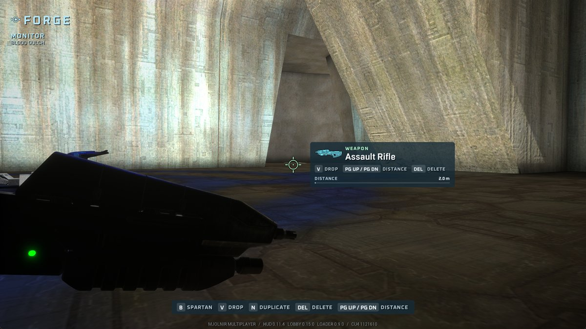
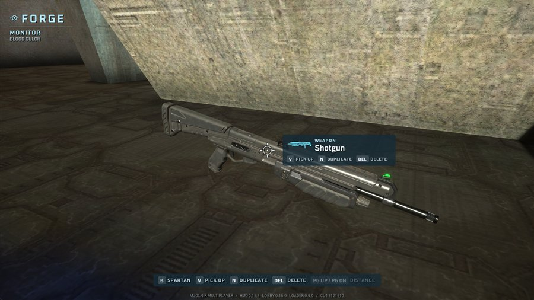
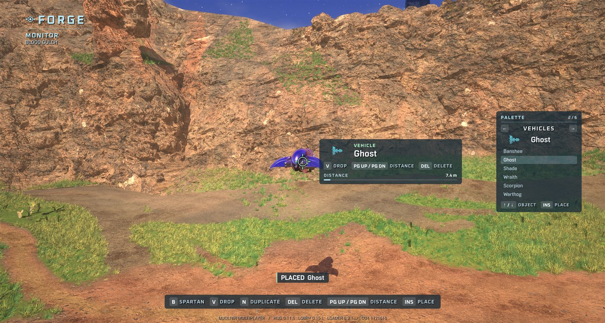

# Forge

Forge lets you build with a map's palette, change object properties and save
layouts for play. **F3** selects physics modes, **F4** sets the position grid
and **F10** selects rotation increments. Custom packs add modular building
pieces and utilities. Forge editing is host-only.

Use **MJOLNIRForge 0.4.0**, **MJOLNIRLobby 0.19.2** and
**MJOLNIRLevelLoader 0.9.8** or newer together, with the matching CE runtime
and map dependencies.

New to building? Start with [Your first Forge build](forge_guide.md), a raised
courtyard walkthrough with doors, lifts and teleporters. This page is the
complete control reference. See [how the engine works](re/forge_engine.md)
for implementation details.

Halo Reach's Forge is still inside Halo: Campaign Evolved's simulation.
MJOLNIR switches it on: you turn into the Monitor, fly around the map, and
pick up, move, drop and delete its objects. The game's own Forge engine does
the work; MJOLNIR gives it keys and a HUD. As the Monitor you can also
place new objects from the map's palette: weapons, vehicles, equipment and
scenery.

Community model sets use [Forge packs](forge_packs.md). Maps declare their
supported pack pieces when baked; the Hub catalog and launcher handle their
releases and dependencies. That guide includes the original Foundry set,
authoring commands and saved-layout compatibility checks.
For a model-to-pack walkthrough, see [Community pack authoring](forge_pack_authoring.md).

## Starting a Forge game

After a fresh launch, press **Enter** at the title screen and wait for sign-in
to finish and the main menu to appear.

1. MULTIPLAYER → HOST GAME, pick a map.
2. Pick **FORGE** as the game type. It is listed once MJOLNIRForge is
   installed and the CE runtime pack has the monitor fix.
3. Start. A panel at the top left says `FORGE`.

For scripts and tests: `mjolnir_auto host <CODE> forge private` at the
console. Before issuing it after a fresh launch, wait for
`MULTIPLAYER is on the main menu` in the current `UE4SS.log`. Starting before
sign-in can load the Unreal world without starting the native simulation.

## The HUD

- **Top left:** FORGE, whether you are the Monitor or your Spartan, and the
  map.
- **Centre:** the Monitor's cursor. Blue when it rests on nothing, white
  on an object, green while you hold one.
- **Beside the cursor:** what you aim at or hold. It shows the kind of object,
  its name, the game's own picture for a weapon, and what the keys do to it.
  While you hold something, a bar shows how far out it is (1 to 60 m).
- **Bottom:** the main controls, dimmed when they do nothing right now, and a short
  note of what the last key did ("DELETED Shotgun").

- **Right, as the Monitor:** the palette. The category (WEAPONS, VEHICLES,
  EQUIPMENT, SCENERY) between its keys, the object Insert places with its
  picture, and the category's list around it. A dimmed entry is one the map
  cannot place right now.

The HUD also shows the target's physics mode and keeps the
grid and rotation settings visible in Monitor mode. The palette header
shows the turn increment separately: snapping off still leaves comma and
period turning by 22.5°.

The HUD ships in the CE runtime pack (`pakchunk980-MJOLNIRFORGEUI-Windows`).
Without it, a plain text panel shows the same things.

## Keys

| Key | What it does |
|---|---|
| **B** | Turn into the Monitor, or back into your Spartan |
| **V** | Pick up what the cursor is on; press again to drop it |
| **Page Up / Page Down** | Push a held object away, or pull it in |
| **Delete** | Delete what you hold (or, holding nothing, what you aim at) |
| **N** | Duplicate the target at the cursor |
| **Insert** | Place the palette's selected object at the cursor; you hold it, ready to move |
| **Left / Right** | Previous / next palette category |
| **Up / Down** | Previous / next object in the category |
| **F5** | Save this map's layout |
| **F6** | Load the saved layout, replacing the objects on the map now |
| **F2** | Go back to the map's own layout (the saved one is kept in `layouts\history`) |
| **K** | Team of the target: neutral, red, blue |
| **L** | Megalo label of the target (the map's labels in turn, then none) |
| **J** | Respawn time of the target: 0, 5, 10, 15, 30, 45, 60, 90, 120, 180 s |
| **O** | Spawn order of the target: 0 to 9 |
| **P** | Teleporter channel of the target: alpha through zulu, then 26–31 |
| **, / .** | Turn what you hold or carry, or the next marker you place, left / right; 22.5° with rotation snapping off |
| **F3** | Cycle the target's physics: Normal → Fixed → Phased |
| **F4** | Cycle the position grid: off → 0.25 → 0.5 → 1 → 2 → 4 m |
| **F10** | Cycle rotation snapping: off → 90° → 45° → 30° → 15° → 5° |

As the Monitor you move with your usual movement keys and the mouse; jump
flies up.

To use other keys, create `keys.txt` in the MJOLNIRForge mod folder with
lines like `grab=H` (actions `toggle`, `grab`, `duplicate`, `delete`,
`nearer`, `farther`, `place`, `prev_category`, `next_category`, `prev_item`,
`next_item`, `save`, `load`, `revert`, `team`, `label`, `respawn`, `order`, `channel`,
`rotate_left`, `rotate_right`, `physics`, `grid` and `rotation_snap`;
key names as UE4SS spells them, such as `PAGE_UP` or
`LEFT_ARROW`).
The defaults are keys the game does not use. G, C, Z and X are taken;
MJOLNIRFlyCam uses F7–F9 and the square brackets.

## The palette

A map's palette is its scenario's own Forge palette. Current converted maps
can offer the CE arsenal: 13 weapons, 6 vehicles (not the campaign's flyers),
grenades, power-ups, ammo and scenery such as spawn points, teleporters, flag
stands and health packs. A map with a smaller palette only offers its baked
selection. Adding installed assets does not change that selection.

The **blocks** palette includes a Covenant crate and portable shield. Maps
can also include original namespaced model sets such as Foundry through
[Forge packs](forge_packs.md). Per-kind quotas and overall object capacity
still depend on the map and engine (*Budgets and quotas*).

## Object properties

Every object Forge places carries properties the game types read. K, L, J
and O change the target's (what you hold, else what you aim at); the target
card shows its team and label.

- **Team**: a red flag stand is where the red flag starts in CTF; spawn
  points with a team are that team's. Include neutral spawn markers for
  free-for-all Slayer; red/blue starts alone do not cover that mode.
- **Label**: what a game type looks objects up by. CTF finds flag stands by
  `ctf_flag_return` and team spawns by `ctf_spawn_red` / `ctf_spawn_blue`.
  The list is the map's own labels.
- **Respawn time** and **spawn order** for weapons, vehicles and equipment.

### Physics and snapping

Aim at an object or hold it, then press **F3** to change its physics mode.
These are the game's native Forge object properties:

- **Normal:** uses the object's normal physics. An unsupported piece can
  fall when dropped.
- **Fixed:** stays where you place it, including in midair.
- **Phased:** stays where you place it and allows overlap with other geometry.

For a platform that should remain suspended, choose Fixed or Phased before
dropping it. The target card shows the selected mode; saved layouts keep
the object's physics properties.

**F4** controls MJOLNIR's position grid. It starts off and cycles through
**0.25, 0.5, 1, 2 and 4 metres**, then off again. On placement or drop, the
object's origin aligns to the nearest grid point in world coordinates.
The grid is anchored at the map's world origin; it does not connect model
edges automatically. A Normal object can still move or fall after it lands
on the grid.

**F10** starts with rotation snapping off and cycles through **90°, 45°,
30°, 15° and 5°**, then off again. With a snap selected, comma and period
request a turn to the next angle on that world yaw grid.
With snapping off, they turn by **22.5°**. Turning is around the vertical
axis; pitch and roll controls are not available.

Use **Phased** for precise construction and check the angle after dropping.
A held Fixed object can resist a requested turn when it encounters collision,
and the game's hold motion can settle slightly off the requested angle even
in Phased mode. Rotation snapping is not a guarantee of an exact final angle.

The HUD shows the current grid, snap angle and turn increment. Grid and
angle choices are editing settings for the current session; a saved layout
records the resulting object positions and rotations.

## Markers: flag stands, spawn points, health packs, teleporters

These have no physics, so the Monitor cannot drag them the way it drags a
weapon. Forge handles them its own way:

- **Insert** puts one where the cursor is, facing the way , and . set.
- **V** on one picks it up: it leaves the map and the HUD shows you carrying
  it, properties and all. Turn it with , and . and press **V** again to put
  it down at the cursor. **Delete** while carrying throws it away.
- **N** copies one, properties included.
- They are invisible in game (the bases' stands are separate scenery).
  Aim close to the marker's position to select it.

A flag stand made this way works in CTF: on Blood Gulch, a red stand placed,
labelled `ctf_flag_return`, saved, and the map then hosted as CTF got the red
flag.

### Teleporters

The scenery palette can include **Teleporter Sender**, **Teleporter Receiver**
and **Teleporter 2-Way**. Place an entrance and exit with the same channel;
**P** changes the targeted marker's channel, shown on its target card. The
game's simulation handles travel, including the receiver's facing. Use different
channels for separate routes. A two-way pair uses the same channel at both ends.

New Insert placements start on alpha with a player-only cylinder about 1.07 m
in radius, 1.83 m above and 0.30 m below the marker. Moving, duplicating and
saving preserves the marker's channel and trigger dimensions. Keep the receiver
clear of walls and leave room for the Spartan. The engine supports 32 endpoints
in total, including both ends of each route. Foundry's portal frames and pads
are visible architecture; place functional teleporter markers separately.

### Pack lights

Foundry's light strip and warm/red/blue pylons have optional catalog light data.
MJOLNIRForge attaches a movable point light to each active piece's actor, so
light follows placement and rotation and is removed when the piece disappears.
This also runs in ordinary game modes and when a saved layout starts a match.
The first 64 active lights receive illumination; additional fixtures still
render. Lights currently cast no shadows. Colors and brightness are properties
of the piece's catalog, so use the red or blue variant for team bases.

### Automatic doors and lifts

Use MJOLNIRForge **0.4.0**, MJOLNIRLobby **0.19.2** and
MJOLNIRLevelLoader **0.9.8** or newer together for these utilities.

Foundry Wide's door frames and moving panels are separate pieces. Place the
panel in its closed position inside the matching frame. Use **F3** to keep it
**Fixed** or **Phased** for automatic opening; **Normal** disables automation.
Leave the panel's full upward travel clear: 4 m for the infantry panel and
6 m for the vehicle panel. Return to your Spartan with **B** and approach
the doorway to request opening. The panel waits two seconds after you leave
before closing.

Clear players and vehicles from the doorway before editing it. Entering
Monitor mode attempts to close the panel, but a blocked closing path keeps
it raised. Moving, copying, turning and changing that panel's physics wait
until it can close; the HUD asks you to clear the doorway. Other objects remain
editable. **F5** saves the authored
closed pose even while the live door is
open. Door saves require the host's known closed pose; client saves containing
enabled doors are deferred, and a migrated host must rehost before using them.

For a lift, place the station with open space above its central deck, then
walk up its ramps as a Spartan and steer onto a nearby landing during ascent.
Crossline demonstrates a landing at 4.5 m above ground, four metres above
the station deck. A green teleporter frame or pad still needs the separate
sender/receiver markers and matching **P** channel described above.
Their metadata and current limits are in
[Forge pack utilities](forge_pack_utilities.md).

## With your fireteam

**Forge editing is host-only.** Start it without fireteam members; the lobby
refuses a Forge session with members present. Forge sessions do not appear
in **Find Games**.

Save your layout, return to the lobby and choose the game type you want to
play with your fireteam. The hosted map uses your saved layout. Players need
the map's matching runtime and pack dependencies.

## Budgets and quotas

A map can limit what Forge places: a budget, a price per object, and a most
of each kind. The simulation enforces them, as Reach's Forge did: an object
over its quota or over the budget is refused ("THIS MAP CAN'T PLACE ANOTHER").
The palette shows `placed/most` and the price beside an object that has them,
and the budget spent in its title. The text panel shows the same.

Maps set them when they are built (`blam.forge` in the level file,
[level_format.md](level_format.md)). A map without prices or per-kind quotas
still has the engine's overall object capacity.

## Layouts

F5 saves what is on the map now, everything Forge can move, as a layout:
`layouts\<MAP>.mvar` in the MJOLNIRForge mod folder (Blood Gulch is
`BGL.mvar`). It works as the Monitor or as your Spartan, in a FORGE game.

**A map with a saved layout starts every game with it**: FORGE, Slayer, CTF
or any other game type on that map. Saving again replaces it; the one before
moves to `layouts\history` with the time in its name. To play the map as it
shipped, press F2 in a FORGE game (or move the file out of `layouts`).

F6 puts the saved layout back on the spot, undoing everything since the last
save. Objects you are holding are dropped first.

A layout file is a Halo Reach map variant (`.mvar`), the same format MCC
uses, so `cargo run -p blam-megalo --example mvar_summary -- BGL.mvar`
lists what is in it. Layouts belong to one map: the file name says which.

## Not there yet

- **Several layouts per map, and picking one in the lobby.** One saved layout
  per map for now; `layouts\history` keeps the older ones.
- **Layouts for your fireteam.** A saved layout is used when you host;
  players who join see the host's objects.
- **A Forge menu** (object lists, properties).
- **Tilting.** , and . turn about the vertical only.
- **Markers are invisible**: aim near where you put them.
- The cursor only reaches things in plain view: it stops at walls and the
  ground.
