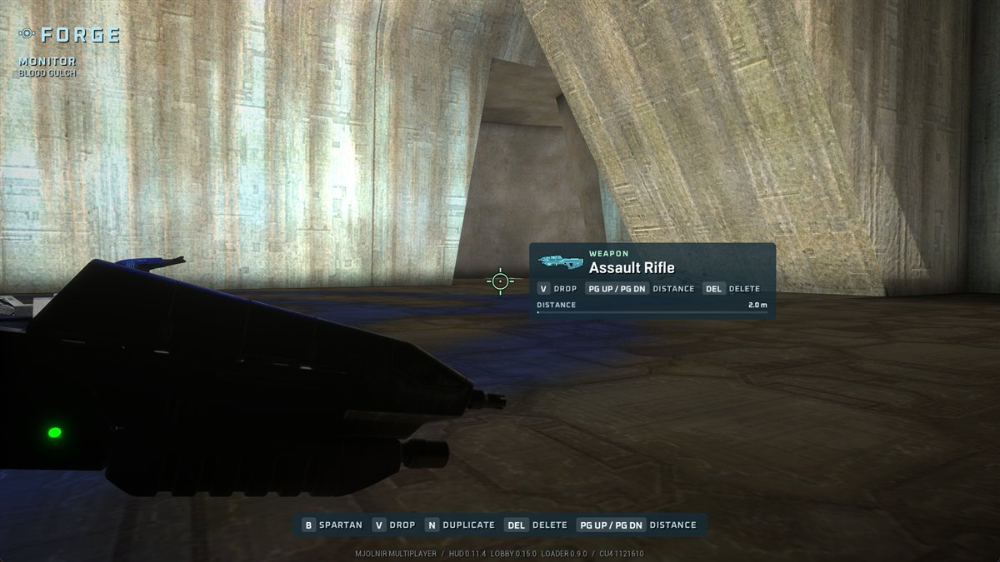
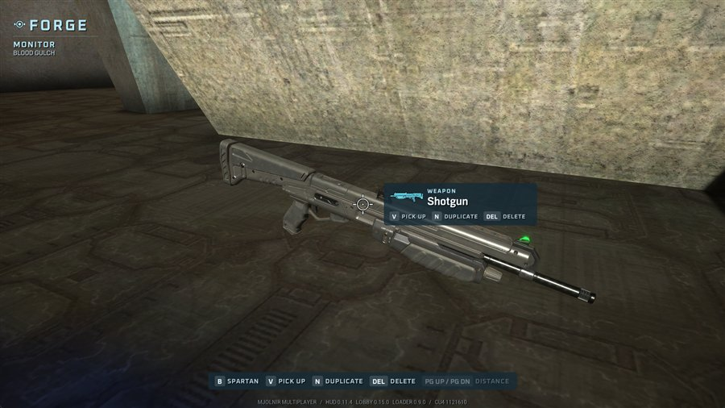
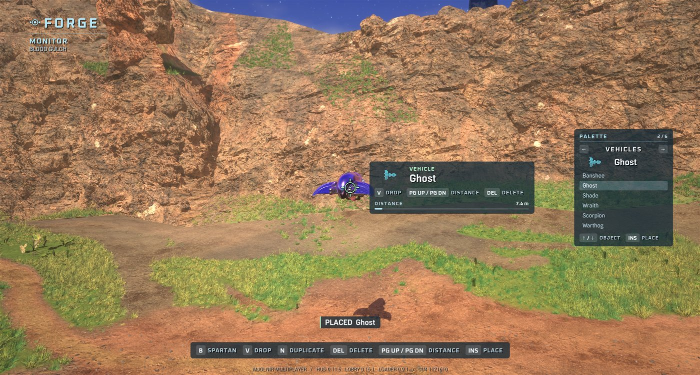

# Forge

**Status:** 2026-10-24. Host only, on any converted multiplayer map.
Released in mods 0.34.0 with CE runtime 1.14.0. Placing from the palette and
the palette panel are not released yet: they need MJOLNIRForge 0.2.0 and CE
runtime 1.15.0 (the panel).
**How it works:** [re/forge_engine.md](re/forge_engine.md).

Halo Reach's Forge is still inside Halo: Campaign Evolved's simulation.
MJOLNIR switches it on: you turn into the Monitor, fly around the map, and
pick up, move, drop and delete its objects. The game's own Forge engine does
the work; MJOLNIR gives it keys and a HUD. As the Monitor you can also
place new objects from the map's palette: weapons, vehicles, equipment and
scenery.

## Starting a Forge game

1. MULTIPLAYER → HOST GAME, pick a map.
2. Pick **FORGE** as the game type. It is listed once MJOLNIRForge is
   installed and the CE runtime pack has the monitor fix.
3. Start. A panel at the top left says `FORGE`.

For scripts and tests: `mjolnir_auto host <CODE> forge private` at the
console.

## The HUD

- **Top left:** FORGE, whether you are the Monitor or your Spartan, and the
  map.
- **Centre:** the Monitor's cursor. Blue when it rests on nothing, white
  on an object, green while you hold one.
- **Beside the cursor:** what you aim at or hold. It shows the kind of object,
  its name, the game's own picture for a weapon, and what the keys do to it.
  While you hold something, a bar shows how far out it is (1 to 60 m).
- **Bottom:** every key, dimmed when it does nothing right now, and a short
  note of what the last key did ("DELETED Shotgun").

- **Right, as the Monitor:** the palette. The category (WEAPONS, VEHICLES,
  EQUIPMENT, SCENERY) between its keys, the object Insert places with its
  picture, and the category's list around it. A dimmed entry is one the map
  cannot place right now.

The HUD ships in the CE runtime pack (`pakchunk980-MJOLNIRFORGEUI-Windows`).
Without it, a plain text panel shows the same things. The HUD from CE runtime
1.14.0 has no palette panel; with it a note names each object you select.

## Keys

| Key | What it does |
|---|---|
| **B** | Turn into the Monitor, or back into your Spartan |
| **V** | Pick up what the cursor is on; press again to drop it |
| **Page Up / Page Down** | Push a held object away, or pull it in |
| **Delete** | Delete what you hold (or, holding nothing, what you aim at) |
| **N** | Duplicate the target at the cursor |
| **Insert** | Place the palette's selected object at the cursor; you hold it, ready to move |
| **Left / Right** | Previous / next palette category |
| **Up / Down** | Previous / next object in the category |

As the Monitor you move with your usual movement keys and the mouse; jump
flies up.

To use other keys, create `keys.txt` in the MJOLNIRForge mod folder with
lines like `grab=F7` (actions `toggle`, `grab`, `duplicate`, `delete`,
`nearer`, `farther`, `place`, `prev_category`, `next_category`, `prev_item`,
`next_item`; key names as UE4SS spells them, such as `PAGE_UP` or
`LEFT_ARROW`).
The defaults are keys the game does not use. G, C, Z and X are taken.

## The palette

A map's palette is its scenario's own Forge palette. Converted maps baked
since 2026-10-24 list the whole CE arsenal: 13 weapons, 6 vehicles (not the
campaign's flyers), grenades, power-ups and ammo, and the map's scenery
(spawn points, teleporters, flag stands, health packs). Maps baked before
list only the kinds they already place, so you can place and duplicate
those but not, say, a Wraith on Blood Gulch, until the map is republished.
There is no limit on how many of each.

## Not there yet

- **Saving a layout.** Changes last until the game ends.
- **Playing with your fireteam.** Players who join start Slayer instead.
- **A Forge menu** (object lists, properties, rotation).
- The cursor only reaches things in plain view: it stops at walls and the
  ground.
