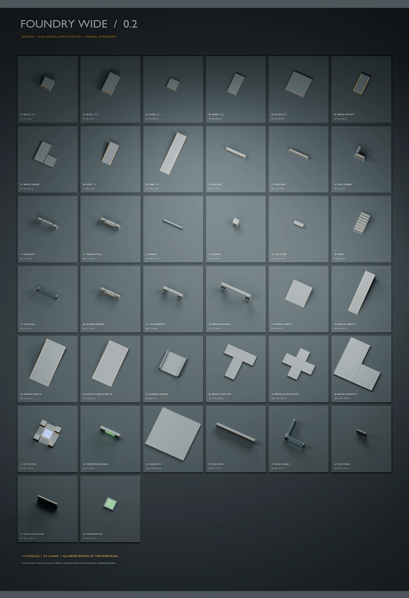
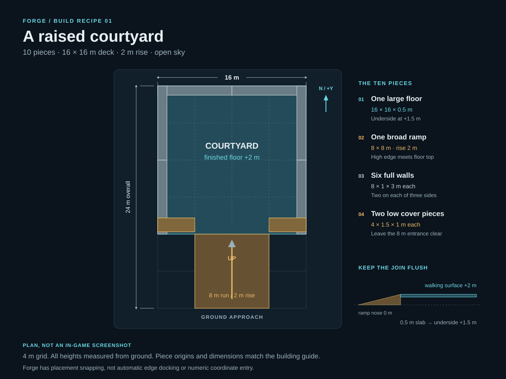
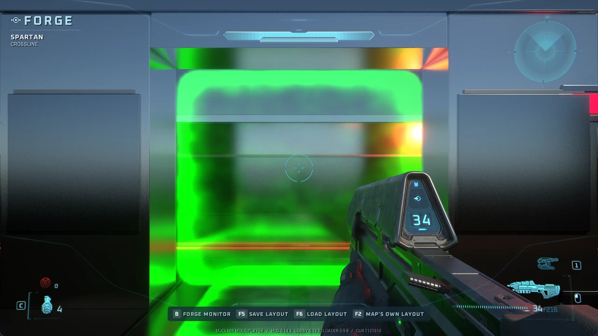
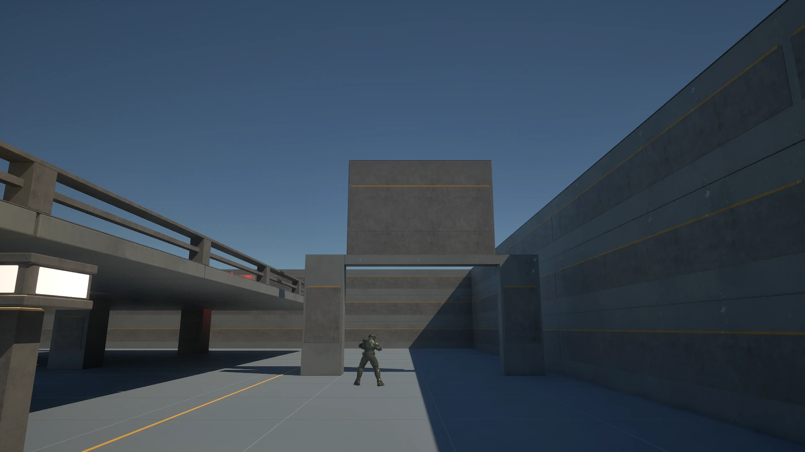
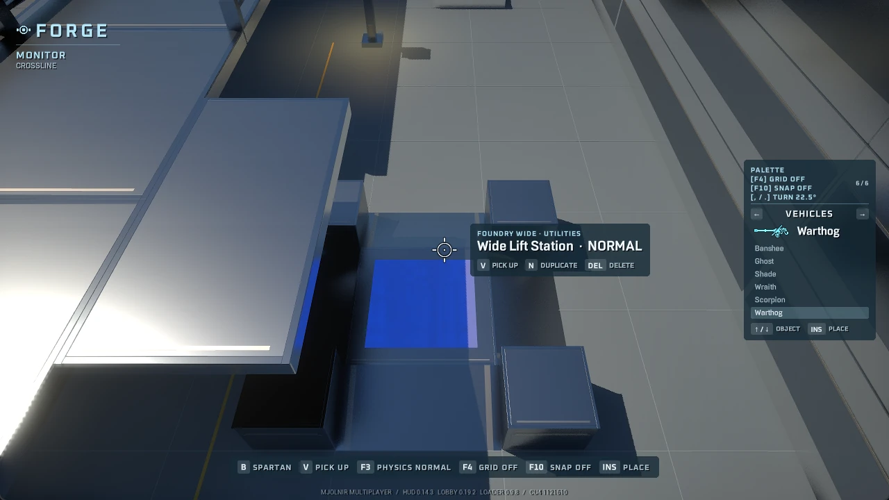
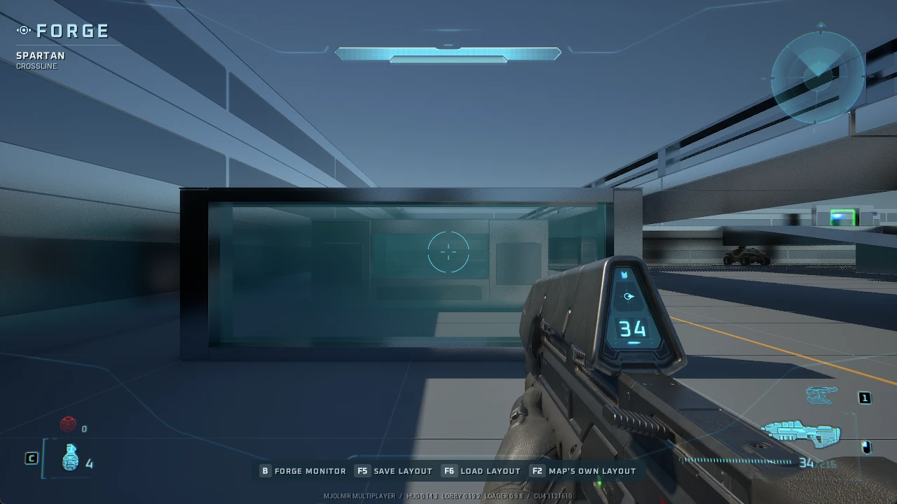
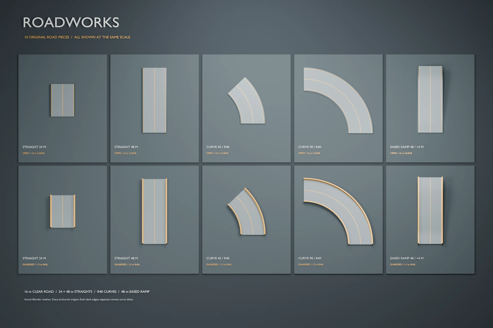

# Your first Forge build

Build a raised courtyard, walk through it as a Spartan, then add the details
that make it a playable space: cover, spawns, doors and a route back up.
MJOLNIR exposes the game's native Forge editor and adds modular construction
packs, a palette and keyboard controls.

This guide uses **Foundry Wide 0.2** and MJOLNIRForge's placement controls.
Forge editing is host-only. Use the matching maps and runtime together;
the utility pieces require MJOLNIRForge 0.4.0, MJOLNIRLobby 0.19.2 and
MJOLNIRLevelLoader 0.9.8 or newer.

*Blender render of Foundry Wide. The pack contains 38 pieces; their original
heights remain player-sized while the larger floor and wall modules give you
room to build.*

[Open the full-size Foundry Wide catalog](images/forge-showcase/foundry-wide.webp).

## Choose a place to build

After launching the game, press **Enter** at the title screen and finish
sign-in. From **Multiplayer → Host Game**, choose a map and **Forge**.

For the example below, use **Crossline**: its palette includes
all original Foundry and Foundry Wide pieces. Find a clear area for the build
and leave its existing spawn points intact. **Forge Canvas** is the simpler
64 × 64 m blank starting deck, but its current palette contains original
Foundry, not Foundry Wide. **Roadworks Circuit** is the place to try the
vehicle kit.

A map must include a pack's pieces in its baked palette. Installing another
pack does not automatically add its pieces to every map.

Press **B** to become the Monitor. Use your normal movement and mouse controls
to look around. The target card beside the cursor names the object you are
aiming at or holding; the palette appears on the right.

## Learn the small set of building controls

| Action | Key |
| --- | --- |
| Switch Monitor / Spartan | **B** |
| Choose palette category / item | **Left / Right**, then **Up / Down** |
| Place the selected piece | **Insert** |
| Grab / drop the targeted piece | **V** |
| Bring a held piece closer / move it farther | **Page Down / Page Up** |
| Turn left / right around the vertical axis | **Comma / Period** |
| Duplicate / delete the target | **N / Delete** |
| Change target physics | **F3** |
| Change position grid / rotation increment | **F4 / F10** |
| Save / reload this map's saved layout | **F5 / F6** |
| Restore the map's authored layout | **F2** |

Start with **F4: 0.5 m** and **F10: 90°**. These suit the rectangular kit.
The position grid aligns an object's origin when it is placed or dropped;
it does not pull adjacent edges together while you hold it. Rotation controls
turn around the vertical axis only.

For construction, use **F3** to choose **Phased** before dropping a piece.
It stays in position and lets you overlap adjoining geometry. **Fixed** also
stays in position, but contact while carrying it can resist the turn you
requested. **Normal** uses the object's authored physics: a stock weapon can
fall, while a structural model authored with fixed bodies can remain still.
Phased construction still provides the intended player collision.

Check the final orientation after each drop. Native holding motion can settle
slightly away from the requested angle; the grid is a placement aid, not an
automatic model-connection tool. The HUD keeps your current settings visible.

## Build a raised courtyard

This ten-piece exercise creates a **16 × 16 m** courtyard whose walking surface
is **2 m** above the ground. The approach ramp adds another **8 m** of length.
The diagram uses north for the ramp's uphill direction.

| Piece in the Wide palette | Quantity | Size and role |
| --- | ---: | --- |
| Wide Floor 4 x 4 | 1 | 16 × 16 × 0.5 m deck |
| Wide Ramp 8 m / Rise 2 m | 1 | 8 × 8 m approach, rising 2 m |
| Wide Wall Full | 6 | 8 × 1 × 3 m walls around three sides |
| Wide Low Cover | 2 | 4 × 1.5 × 1 m front flanks, leaving an 8 m entrance |

1. **Place the floor.** Set it to Phased. Its origin is the centre of its
   underside, so an underside **1.5 m** above the ground puts the walking
   surface at **2 m**. The 0.5 m grid matches both heights.
2. **Connect the ramp.** Set its low end on the ground and turn its high end
   toward the courtyard. Its high edge meets the floor's near edge at 2 m.
   Keep both edges flush; raising the floor's underside to 2 m would create
   a 0.5 m step at the join.
3. **Enclose three sides.** Place two full walls along the back, then two
   along each side. Their bottoms sit on the finished floor. Turn the side
   walls by 90°. Keep their outside faces on the deck's outside edges.
4. **Frame the entrance.** Place one low cover piece on either side of the
   ramp mouth. They leave an 8 m-wide opening and give the courtyard a
   readable front without obstructing the approach.
5. **Walk the route.** Press B, approach from the ground and walk up the
   ramp. Cross the join in both directions, follow the wall edges and check
   that the entrance remains wide enough when you turn into it.
6. **Save a working version.** Press F5 before adding decorative pieces or
   experimenting with a different layout.

For a more exact plan, treat the floor centre as `(0, 0)` and ground as `Z=0`.
These are relative planning coordinates in metres; the editor has no numeric
position-entry panel.

| Piece origins | Position | Turn |
| --- | --- | --- |
| Floor | `(0, 0, 1.5)` | None |
| Ramp | `(0, -12, 0)` | Uphill toward +Y |
| Back walls | `(-4, 7.5, 2)` and `(4, 7.5, 2)` | None |
| Left walls | `(-7.5, -4, 2)` and `(-7.5, 4, 2)` | 90° |
| Right walls | `(7.5, -4, 2)` and `(7.5, 4, 2)` | 90° |
| Front cover | `(-6, -7, 2)` and `(6, -7, 2)` | None |

The [piece reference](../forge-packs/foundry-wide/README.md) has dimensions
for the smaller floors, stairs, corners and bridges. Use them to extend the
same courtyard rather than guessing a piece's size from its thumbnail.

## Give players a way in, out and back into the game

Place **spawn point markers** from the scenery palette on clear walking
surfaces. **K** cycles the target's team between neutral, red and blue.
Keep red and blue starts inside their own bases, with room for a standing
Spartan and a clear first step.

If the map will support **free-for-all Slayer**, include **neutral spawn
markers**. Red and blue starts alone do not cover that mode. Place several
neutral starts around shared areas, away from vehicle traffic and the lift
column. Team games prefer matching initial starts, but can also use neutral
starts for ordinary respawns.

Markers are invisible gameplay objects. Aim close to their position to select
them; V carries a marker and its properties, and N copies it. Leave working
starts in place until you have tested replacements by hosting the intended
game type.

## Add a teleporter route

The green housing and pad make the route visible. **Separate native markers
perform the teleport.**

Place a **Teleporter Sender** at the entrance and a **Teleporter Receiver**
at the destination, or use two **Teleporter 2-Way** markers. Target each and
press **P** until both show the same channel. Use another channel for another
route. Turn the destination marker so arrivals face into the playable space.

The Wide pad is 0.5 m thick. Put its underside 0.5 m below the adjoining
finished floor if you want a flush approach, then place the gameplay marker
at the usable entrance. Keep the receiver and the space beyond it clear.
Test both directions as a Spartan. Walk away from the arrival trigger before
trying to return; native teleporters have a rearm distance.

## Make a doorway open automatically

The **frame and panel are separate pieces**. Pair Wide Tall Doorway with
Wide Door Panel, or Wide Vehicle Doorway with Wide Vehicle Door Panel.
Place the frame on a continuous floor, then place the panel at its closed
height. Align their horizontal centres and set the panel 0.75 m toward the
frame's local front (−Y), so it sits just ahead of the frame.

Use **F3: Fixed or Phased** on the panel. Normal disables automatic movement.
Leave clear space for the panel to rise: **4 m** for the infantry door and
**6 m** for the vehicle gate. Static construction above it is not an automatic
stop, so keep the whole travel path clear.

Return to your Spartan and approach. The panel opens, then waits two seconds
after you leave before closing. A nearby player or movable vehicle can keep
it open. Before editing the panel, clear the opening and enter Monitor mode;
if the closing path is occupied, the panel stays raised and its edit waits.
Other pieces remain editable. F5 saves the door's closed design position,
even when the panel is currently open.

## Connect a lift to a gallery

Place **Wide Lift Station** on the ground with its central column open above.
Its four shallow ramps lead to a deck 0.5 m high. A nearby gallery at **4.5 m**
above the same ground gives this preset a useful landing four metres above
the lift deck.

Keep the landing beside the column rather than directly over it. Walk onto
the centre as a Spartan and steer sideways onto the gallery during the rise.
Staying centred can produce repeated rises. Crossline demonstrates a ground
approach, ascent and controlled gallery landing; use its spacing as a starting
point and test your own geometry. Keep a conventional ramp route available
while you tune the landing.

## Finish with glass, lights and the right scale

Glass walls and glazed windows are transparent, solid and non-breakable.
Use them where players should see a route without walking through it.
Original Foundry's warm, red and blue pylons help distinguish entrances and
team bases. Their lights follow the placed fixtures and currently cast no
shadows.

For vehicles, use the dedicated Roadworks kit. Its **16 m clear roadway**,
24/48 m straights and 40 m-radius curves give a Warthog much more space than
a 4 m-wide pedestrian bridge. The stock vehicle's visual envelope is roughly
6.13 × 3.25 m; leave room to turn, pass and recover as well as fit through.
Road connector positions are documented for authors, but Forge does not
automatically dock them or provide checkpoints and lap timing.

*Blender render.* [Open the full-size Roadworks catalog](images/forge-showcase/roadworks.webp).

## Save, reload and play

**F5** saves one layout for the current map. **F6** replaces the current
objects with that saved layout, so use it to check that your build restores
correctly. **F2** returns to the map's authored layout and preserves the old
save in history.

A saved layout also applies when you host that map as Slayer or another game
type. Return through the lobby and try the mode you intend people to play:
check its spawns, walk every join, use both teleporter directions and try the
doors as a Spartan. Door layouts should be saved by the host; a session that
changes host needs a rehost before door automation and saves resume.

Keep a layout's `.mvar` and `.mvar.packs` files together when backing it up.
The companion records the pack identities the layout needs. Matching pack
versions matter: changing a model or palette can change what an old placement
means. The launcher dependency workflow handles declared pack requirements;
copying a lone layout file is not a substitute for those assets.

For the full key and property reference, see [Forge controls](forge.md).
To create your own models and submit a pack, continue with the
[community pack authoring guide](forge_pack_authoring.md). The
[utility reference](forge_pack_utilities.md) describes door, lift and surface
metadata; the [validation record](forge_pack_validation.md) keeps the detailed
test evidence separate from this building guide.
