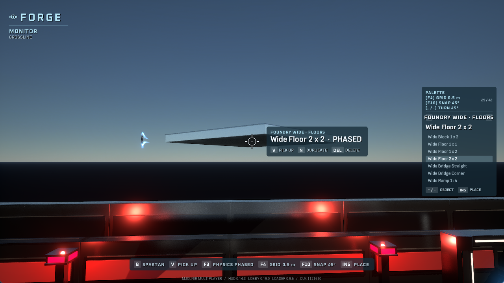
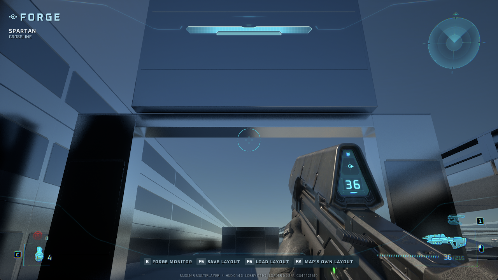
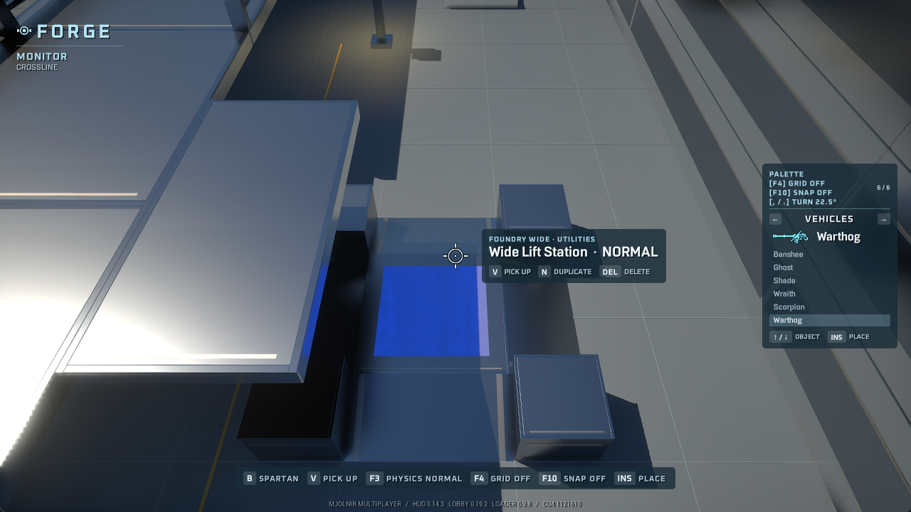
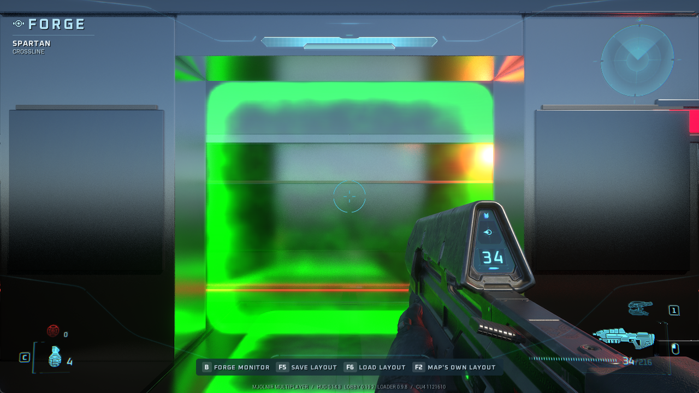
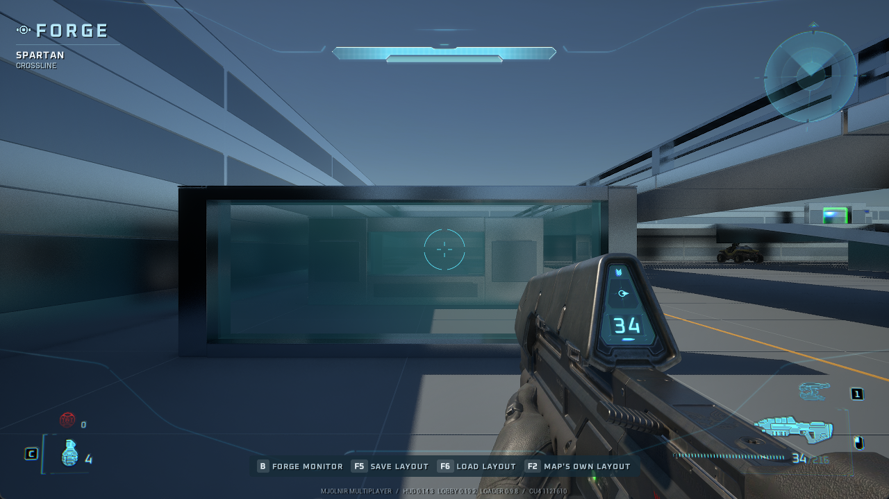

# Foundry Forge pack validation

Evidence recorded on **2026-11-01**, using CU4 and a private, isolated local
`FPK` map fixture. This tests the original 18-piece Foundry set and the new
pack-aware Forge pipeline. See [forge_packs.md](forge_packs.md) for the build and
distribution contract.

## Observed in the game

| Check | Result |
| --- | --- |
| Load custom tags | 72 namespaced tags loaded: 18 piece types × collision, physics, model and crate |
| Place pieces through Forge | All 18 types placed; native object counts confirmed the placements |
| Render the custom actor | The cube and doorway rendered using their new actors and meshes |
| Authored labels | Forge displayed the pack and block labels from the installed catalog |
| Grab and move | The placed cube's position changed through Forge movement |
| Rotate | Rotate-right changed the cube's rotation by 22.5° |
| Save, delete and reload | Reload restored the saved position and rotation after deletion |
| Save pack identities | The `.mvar.packs` file contained 18 bindings with the exact installed archive hash |
| Missing sidecar | Removing the sidecar caused the layout to be refused |
| Changed installed hash | A mismatched inventory hash caused refusal with `needs foundry 0.1.0` |
| Restart and automatic loading | A full game restart restored all 18 custom pieces and the spawn marker from the saved layout |
| Player standing collision | The Spartan settled at Z 4.97 wu on the cube at Z 4.32 wu, matching its 2 m height; remained stable, then fell to Z 0.02 after walking off |
| Floor collision | The Spartan settled at Z 0.69 wu on Floor 2 x 2 at Z 0.52 wu, matching its 0.5 m thickness |
| Ramp traversal | Walking up the ramp raised the Spartan from Z 1.11 to 1.22 and 1.36 wu as Y increased, matching the 1:2 slope |
| Doorway opening and lintel | The player fell through the open centre below the lintel; a drop from above settled on the lintel at Z 11.58 wu, matching its 3 m height above Z 10.60 |

All 18 types were placed and counted; the cube and doorway received representative
visual review in game. The Blender contact sheet and Crosswalk
assembly show the authored geometry and material design. The game build uses
stock material references on the original geometry, so those Blender renders
do not establish the final in-game surface appearance.

## Automated and offline evidence

| Area | Completed checks |
| --- | --- |
| Collision geometry | 9,950 rays against generated collision and the source triangles, including face probes and axis sweeps |
| Launcher | 90 tests passed; 5 ignored. Includes a local HTTP fixture for exact-version dependency download and refusal to replace a live pack |
| Hub | 40 tests passed; type check and focused lint passed. Includes upload/scan/catalog visibility and version validation |
| CLI | 8 focused Forge tests passed; 2 new-tag tests passed. Includes signatures, malformed containers, custom scenario preloads and hyphenated namespaces |
| Live tag lookup | 14 tag-table tests passed; the generated-scenario alias was also verified by live field writes during collision testing |
| Lua | 39 checks passed; 62 Lua files passed syntax/lint checks |
| Native Forge | 684 portable checks passed, including identity guards, paired-file failure injection and BLF marker handling; `/WX` build passed |

The HTTP tests use local fixtures. They establish dependency behavior without
claiming that a Foundry release has been published on the production Hub. The
native file tests cover rollback and preservation of previous layout bytes on
save failures; those failure cases were exercised in the portable harness.

## Pending game checks

- Full visual review, floor/ramp joins, stairs, horizontal doorway traversal,
  window openings and vehicle traversal.
- A fresh launcher profile fetching a published Foundry release and its map.
- Multiplayer placement and saved-layout behavior with a second machine.

Offline ray agreement and the representative standing check do not establish
every traversal case or multiplayer behavior.

The local test installation was removed afterward. Seven pre-existing files
were restored and hash-checked, 230 temporary game files were removed, and the
game's display settings were restored. Generated content and captured test
layouts remain in ignored local build/evidence directories.

## Foundry 0.2 and the playable map templates

The follow-up adds 24 Foundry pieces and two actual standalone map archives:
[Forge Canvas and Crossline](../forge-maps/README.md). Separate private local
sessions loaded `FBK` in Forge and `FRB` in Team Slayer on CU4, with CE runtime
1.17.0. These archives are local, unsigned candidates, not published releases.

| Check | Observed result |
| --- | --- |
| Empty canvas | A 64 × 64 m deck with a 2 m grid loaded; the Spartan remained at floor Z=0. The palette contained all 24 Foundry entries plus spawn/sender/receiver/two-way utilities. |
| Crossline assembly | All 98 Foundry placements loaded alongside eight spawn and two teleporter markers. |
| Raised route | Walking from the blue base along the side catwalk retained Z=1.48 wu, matching the 4.5 m deck surface. The paired central ramps supported walking down and back up through their join. Dropping to the lower route settled at Z=0. |
| Teleporter route | Walking onto the flush pad transported the Spartan between the two bases in both directions. Leaving the destination trigger and re-entering re-armed the route. |
| Forge utility creation | Insert created a two-way marker with the expected cylinder dimensions (0.35 wu radius, 0.6 above, 0.1 below); P changed its channel from alpha to bravo. |
| Attached lights | Eight real point-light components existed in Team Slayer: four coloured and two warm pylons at 7,000 cd / 8 m radius, and two strips at 2,500 cd / 6 m radius. Component positions matched each actor and its declared offset. |
| Visible illumination | With the canvas sun/sky temporarily disabled for diagnosis, the warm pylon produced a visible pool on the floor. Coloured lights illuminated Crossline's walls and the player's weapon. |
| Light cleanup | Reverting the canvas removed the placed pylon's point-light component while its pooled actor became hidden. |
| Kill floor | Walking beyond Crossline's floor triggered the loader's -600 cm kill floor and the multiplayer respawn sequence. |
| Map travel | A fresh process completed Crossline → lobby → Forge Canvas → lobby → Crossline with working HUDs and eight lights recreated on Crossline. |
| Final canvas picking | A cold launch with the normal Forge DLL selected and moved both a block and the narrow red pylon using the rebuilt canvas. No diagnostic patch was active. |
| Pylon save/reload | Saved the moved/rotated pylon, deleted it, and loaded the save. Its transform was restored with exactly one attached 7,000 cd light. Deletion hid the pooled actor and removed its attached light. Returning after a Crossline session automatically restored the saved pylon and light. The sidecar recorded the final Foundry archive hash. |
| Chat while editing | Typing B into chat entered text and left Monitor mode active, confirming inactive class placeholders do not mask the live chat widget. |

Playtesting corrected the sky's atmosphere-sun/physical-skylight settings,
raised the lamps from their initially ineffective brightness, and caught
reversed red/blue scenario team names. Red uses `defender`, blue `attacker`.
Portals sit behind the spawn line so approaching from the arena side leaves
the destination facing into play. The central lower landing has a 0.5 m lip;
returning from the surrounding floor requires a jump.

Travel testing also exposed a stale UE4SS UI-property cache after class
collection. The bounded class-retention mitigation and discovery guards are
documented in [custom_ui.md](custom_ui.md#class-lifetime-during-map-travel).
The canvas initially rendered and supported standing but could not select
objects above the floor: the native loader recomputed query bounds from the
slab's vertices. Adding two unreferenced shell vertices expands that envelope
without adding collision surfaces. A temporary bounding-box-only diagnostic
proved the cause; the final cold-launch check used the rebuilt assets and
normal DLL. See [forge_canvas.md](forge_canvas.md).

Offline checks now cover 13,328 Foundry collision probes and 13,068 probes for
each canvas BSP; 24 pieces, 49 convex hulls and 580 collision triangles.
The follow-up passes 92 launcher tests (5 ignored), 41 Hub tests, 13 level
tests, 5 Forge CLI tests, 5 map-builder tests, 1,473 light lifecycle checks,
42 Forge HUD checks, 73 UI class-retention/discovery checks and 1,753 native
Forge checks. The native DLL builds with `/WX`. All 24 emitted model bounds
enclose their authored visual and collision geometry; decoded package
references and extraction integrity checks passed.
Both map archives preserve their authored JSON and pin `foundry =0.2.0` and
`mjolnir-ce-runtime ^1.17.0`; neither embeds a private save or shared map
registration override.

The Blender previews use the actual source placements and original authoring
materials. Runtime meshes currently reference shipped materials; preview
surface appearance is not evidence of the game's final material appearance.
Second-machine play and downloading a published release into a fresh launcher
profile remain pending.

Initial playable candidates (unsigned), before the enclosure follow-up:

| Archive | SHA-256 |
| --- | --- |
| Foundry 0.2.0 | `e136236363744be1b19d3f45898d3bb25f07d0e2ca0534b8bfca5f2fc9375dee` |
| Forge Canvas 0.1.0 | `76a306b560f54794ea9fb5a89ecae621d858003928cfbfce0eea8e07b1b940f2` |
| Crossline 0.1.0 | `1b5e0cf022bff2b23598966caeab408b58db81098e2e20b926f009195c5c9e44` |

The follow-up test installation was removed afterward: twelve pre-existing
game files were restored and hash-checked, temporary map/pack containers and
metadata were removed, and display settings were restored. Test layouts and
diagnostic evidence remain in ignored local directories. Both CI workflows
passed for implementation commit `2a6f014e`.

## Enclosed Crossline and photo session

Crossline now appends 96 existing Full Wall pieces to the original layout:
three 3 m courses form a continuous 9 m perimeter, with overlapping corners.
The original 108 simulation objects, routes, spawns and teleporters remain
unchanged. There are now 194 Foundry placements plus ten gameplay markers.
Forge Canvas remains empty.

Six map-builder tests pass. The enclosure regression uses transformed
collision hulls to check coverage along all four sides at every height band,
corner overlap, and spawn/teleporter clearance. In a fresh private Team Slayer
session, walking east stopped at X=3.60 wu; another 900 ms of movement left X
unchanged. Walking south reached the corner at Y=-6.22 wu. Jumping into the
side wall left the player inside, and the player remained on the lower floor.
Live inspection counted all 194 Foundry pieces.

The [four new gameplay photos](../forge-maps/README.md#gallery) are unedited
1920 × 1080 captures using the existing FlyCam to hide the HUD. They show the
overview, red base, lower route and perimeter. Blender previews are labelled
separately and regenerated from the same enclosed layout.

Latest local archives remain unsigned:

| Archive | SHA-256 |
| --- | --- |
| Foundry 0.2.0, wall-guide README update only | `50107e14652d40e8978ca7401de5bd419fe041c45defb46083f9ea2f9e56e373` |
| Enclosed Crossline 0.1.0 | `77dfd4bfd9588ddcdc5901eb3213c16ed9b47af310bba29089a54080569595f1` |

All 194 Foundry container members are unchanged by that README-only repack.
The original game files, camera poses and display settings were restored and
verified after the session; the temporary installation was removed.

## Roadworks 0.1 validation

The ten-piece [Roadworks kit](../forge-packs/roadworks/README.md) and separate
[Roadworks Circuit / RWC](../forge-maps/roadworks/README.md) were built locally
on 2026-11-01 (final build report `20261102T012552Z-87e4971b`). The map has
18 connected loop pieces, a guarded spur, three test-pad decks, two stock
Warthogs and four player starts. Its road surface is 3 m above the original
160 m canvas, rising to 7 m, so the recovery floor cannot mask road-collision
gaps. The existing Forge Canvas and Crossline level files are unchanged.

| Offline check | Result |
| --- | --- |
| Source geometry | 196 convex hulls / 2,352 triangles; 3,430 road-surface probes passed |
| Native collision | 9,774 rays passed across all ten generated collision tags |
| Model visibility bounds | All ten emitted models decode to a 300 m `render_distance` (98.425194 wu), replacing the inherited zero/default value that selected 91.44 m. The cold-launch check below verifies visibility across roughly 120 m of the course; 300 m was not tested live. |
| Map assembly | Nine builder tests passed, including real-triangle surface checks, connector/deck-edge closure, reversed descent, guard seams, pit access and vehicle spawn surfaces |
| Canvas | 13,068 collision probes passed for the 160 × 160 m slab and expanded playable bounds |
| Packaging | Exact pack palettes and container bytes verified; authored JSON preserved, `vehicles: true`, Slayer/Forge modes, no private layout or shared registration override |

The map pins `foundry =0.2.0`, `roadworks =0.1.0` and
`mjolnir-ce-runtime ^1.17.0`. The retained build report records every input
hash; both archives below were rehashed against the finished files.

| Local unsigned archive | Bytes | SHA-256 |
| --- | ---: | --- |
| Roadworks 0.1.0 | 601,379 | `8a5e7869a5f73866804c3f6d5abf0fe43f50baf8161ccb6116ec68b96f3f7acf` |
| Roadworks Circuit 0.1.0 | 112,962 | `8fc7b93374ecfe054ecedfe3e36cd57b28370f43e634c2f549a3bc38ca4a869b` |

The original 0.1 circuit preview was a Blender render of the generated level
and original pack geometry. Its provenance receipt and the bake agreed on level SHA-256
`44af8c27d83ad60365df3bb28c0522544d047bb9b5b195671cc694fc3dac3854`.
The preview uses authoring materials and omits the stock Warthogs and player
markers. The [current circuit preview](../forge-maps/art/roadworks-circuit.png)
has since been regenerated for 0.2; neither preview is an in-game capture or
vehicle-scale photograph. The
[scale measurements](../forge-packs/roadworks/SCALE.md) come from installed
stock tags; no extracted stock models are shipped in the authored pack.

### First private Slayer drive

The pit Warthog drove onto the spur, crossed the 12/24 m straight joins, a
90° bend and the joints between paired 45° bends. Its native position stayed
at approximately Z=0.98 wu (3 m), with full 500 health. A second stock Warthog
completed the raised route, also retaining full health:

| Ramp position, authored Y | Observed vehicle Z | Road stage |
| ---: | ---: | --- |
| 10.91 m | 1.73 wu / 5.27 m | Climbing |
| -4.94 m | 2.29 wu / 6.98 m | High deck |
| -24.45 m | 1.60 wu / 4.88 m | Descending |
| -39.35 m | 0.98 wu / 2.99 m | Back on the low road |

These drives used ordinary gameplay inputs without live physics or position
patches. The final map archive is byte-identical to the first candidate;
the Roadworks pack changed its model render-distance fields.

The [three gameplay photos](../forge-maps/README.md#roadworks-gameplay-photos)
show the real Spartan and Warthog beside a two-metre ground scale bar, the
course overview and the ramp. The detached FlyCam required temporarily
changing native `CullByBlamVisibility` from 1 to 0 for the overview and ramp
photos so objects culled relative to the native player camera remained
visible. This setting changes visibility only; it did not repair or modify
geometry or collision. It was restored to 1 before every drive and before
quitting the first session.

### Final cold launch, Forge and restoration

A fresh process loaded a private RWC Forge session. Insert placed a
`straight_24`; V grabbed it, D moved it, two period presses rotated it and V
dropped it. F5 saved 67 objects, including the added straight at native
position `(2.50, 11.81, 1.72)` wu and yaw -37.5°. Insert then placed a separate
`curve_90`. F6 removed that unsaved curve and recreated the saved straight at
the identical transform.

The saved `RWC.mvar.packs` bound both releases to their exact installed
archive hashes: Foundry 0.2.0
`50107e14652d40e8978ca7401de5bd419fe041c45defb46083f9ea2f9e56e373`
and Roadworks 0.1.0
`8a5e7869a5f73866804c3f6d5abf0fe43f50baf8161ccb6116ec68b96f3f7acf`.

This final session used the default `CullByBlamVisibility=1` throughout,
without FlyCam. Ordinary S movement took the Monitor to
`(5.87, -20.86, 1.50)` wu, or authored Y=-63.6 m. Readback showed the north
guarded straights at authored Y=56 m with `bHidden=false`, and a screenshot
showed the far road. This establishes cross-course visibility at roughly
120 m; it does not establish the full 300 m render-distance limit.

After quitting, `.dream-loop/roadworks/session.ps1 -Action restore` restored
23 original file states with hash verification and removed the temporary
test packs and maps. Played layouts were retained in the ignored
`played-layouts` evidence directory.

Formal guardrail-impact and two-car passing tests, published Hub installation
and second-machine play remain pending for these candidates.

### Roadworks frame-time investigation

The user's later RWC session exposed repeated hitches and a flashing Forge
HUD. At 2560 × 1440, process 35964 recorded 954 hitches over 5 minutes
55 seconds: median frame time 5 ms, p95 8 ms, p99 91 ms and worst 190 ms.
The largest recurring stalls coincided with the half-second pack-light poll.

Direct timing isolated the cost: the shared world lookup took about 20 ms,
and each of four Blueprint `StaticFindObject` lookups took 15–16 ms.
Actor enumeration and four active-actor checks together took only 0–1 ms.
The final adapter follows the current local player through the process's
`GameEngine` and resolves Blueprint classes afresh through the nonloading
`Conv_SoftClassReferenceToClass` conversion. It caches only native classes
and defaults, never Blueprint classes or departing controllers, and does
not load pack assets in the frontend or during travel. The combined lookup
probe measured 0–1 ms warmed, with an initial 5 ms result.

The HUD flashing was a separate consequence of the stall: a native 100 ms
poll advertised `forge=0` whenever it saw no new simulation snapshot.
It now allows one second without progress before declaring Forge inactive;
repeated polls cannot extend that deadline. Forge HUD and pack-light work
also report through `MJOLNIR.work`, so future hitch logs can attribute their
cost. The focused light suite passed 1,531 checks and the native suites
passed 1,788 checks, including the heartbeat timeout and wrap boundaries.

The user's 66-object layout was saved, preserved and loaded again in cold
process 48988. With the Monitor palette visible at the same 2560 × 1440
quality settings, a 61-second sample covered 9,815 frames: median 6 ms,
p95 7 ms, p99 7 ms and worst 34 ms. It recorded 21 hitches, all below 50 ms;
the recurring 90 ms stalls were absent in this window. Pack-light work
averaged 0.5 ms per second, with a worst individual run of 1 ms. Four
7,000 cd point-light components still reported `visible=true`.

A separate 45.0456-second state-file sample contained 712 valid `forge=1`
observations and no `forge=0` observations; five partial reads were ignored.
This is a short, roughly one-minute performance check with a different
camera position from the user's baseline, not a claim of zero hitches or
long-session performance. The game was left open in Monitor mode for the
user with the saved layout loaded.

## Roadworks 0.2 enlargement

User driving feedback led to doubling the road kit's horizontal dimensions:
16 m clear width, 24/48 m straights, R40 curves and a 48 m ramp rising 4 m.
The ramp has a maximum 12.5% grade. Deck thickness and road elevations remain
unchanged; guardrails increase from 1 m to 1.5 m. The circuit is now 731.33 m
long on a 320 × 320 m recovery floor, with 22 Roadworks placements, 68 original
Foundry half-walls, four original light pylons, four player starts and three
stock Warthogs. That update did not resize original Foundry, Crossline or
Forge Canvas; the subsequent Crossline enlargement is recorded below.

The source validator passed 3,430 surface probes and all 196 convex hulls /
2,352 triangles. Native collision passed 9,774 rays; the expanded canvas
passed 13,068 probes. All ten new physics payloads were cooked and verified.
Nine map-builder tests passed, including full 6.13 × 3.25 m vehicle footprints
through real curve/ramp triangles and across the staged two-car straight.
Those cars have 4.75 m between their visual envelopes and 2.375 m to each
outer guard when centred in their lanes; these are static clearance checks.

An independent read of all ten exported glTF binary POSITION buffers matched
the source visual bounds within 1.69 micrometres, with no hidden node scale.
The regenerated Blender circuit preview and the native bake both use level
SHA-256 `67d21abd08ee8d2bd4c6ea2fd19586113271e0e6c1f10ebce53790754861fa66`.
The preview omits stock vehicles and player markers. The two-metre ground
scale bar is still two metres; stock vehicles and players are unchanged.

Build `20261102T042113Z-e9c5c8b3` verified all required cooked pack bytes and
exact palettes before packaging. The map pins Foundry and Roadworks `=0.2.0`
and CE runtime `^1.17.0`. These remain local unsigned candidates:

| Archive | Bytes | SHA-256 |
| --- | ---: | --- |
| Roadworks 0.2.0 | 602,284 | `d7a22818b93a4a7914df938608d237e4dde89b6d12cffcbebc0dbfd716426d96` |
| Roadworks Circuit 0.2.0 | 113,937 | `13c69fe1a61b1a6625acbded114c3e22f21cd3dd1c10417a72adcb9b1f4f66ce` |

Crossline and Forge Canvas were installed together with a rebuilt 52-map
menu registry. Crossline was observed running in a signed-in private Forge
session at its existing scale for the user's playtest. No change to its
geometry or Foundry release was made.

Roadworks 0.2 was then installed with a verified backup of the previous
release archives and active RWC layout. The fresh installation preserved
Foundry, both other maps and the runtime performance fixes. The user reported
the new road scale was much better. Automated driving validation of this
enlarged release was interrupted and is not claimed by the earlier 0.1 record.

## Crossline 0.2 and Foundry Wide

The user's first Crossline playtest found its 24 × 40 m plan too small.
Crossline 0.2 expands to 48 × 80 m with the separate Foundry Wide 0.1 pack.
Wide derives the eighteen original structural pieces with X/Y doubled and Z
unchanged: 8 × 8 m floor tiles, 4 m bridges, 8/16 m ramps with a 2 m rise,
1 m cover, 0.25 m stair rises and 4 m doorway openings. Native model tags
author a finite 200 m draw distance. The original Foundry pack and all stock
player, weapon, teleporter and light shapes retain their previous dimensions.

The source pins original Foundry geometry by canonical JSON SHA-256 and
checks exact vertex transforms, unchanged topology/Z and four times the
original hull volumes. Regeneration is deterministic. The portable validator
passed 35 closed convex hulls / 412 collision triangles and 766 aperture,
ramp and stair probes. Native collision passed 9,950 rays and all eighteen
physics payloads were cooked and verified. The 48 × 80 m canvas passed
13,068 collision probes.

The map still has 204 simulation placements: 182 Wide structures, twelve
original portal/pad/light pieces and ten gameplay markers. Eight spawn points,
three weapons and two equipment pickups retain their original heights. Ten
map-builder tests passed, including the continuous 9 m perimeter and corner
overlaps, real-triangle ramp/floor joins, clear doorways, spawn support and
portal landing clearance. Raised decks remain at 4.5 m and teleporter trigger
dimensions and channels are unchanged. Blank and Roadworks source bytes and
the original Foundry catalog remain unchanged.

The enlarged Crossline level SHA-256 is
`0036422121c5917b7f511ce2326fe46d565c1fc9eca80957d8c9dbea80f86203`.
The dedicated map README, exact pack palettes and expanded canvas receipt
are inputs to the versioned bake. Historical Crossline 0.1 gameplay photos
remain labelled separately from new previews and live evidence.

An independent audit decoded all eighteen glTF/BIN and GLB exports and the
cooked mesh/actor/native tags. Export nodes have identity transforms and
full-size bounds; all collision/physics/model references, restored origins,
200 m draw distances and Blueprint references match the source. All 108
generated package names stay in the separate `foundry-wide` namespace.
Archive CRC, member uniqueness and exact current content bytes passed.

Build `20261102T043837Z-c294c163` verified the frozen map and pack inputs and
produced these local unsigned candidates:

| Archive | Bytes | SHA-256 |
| --- | ---: | --- |
| Foundry Wide 0.1.0 | 981,879 | `0d7c48b7d92f4783d8977b1bccc96fc288fd65ad3700c3d03fa92d92e6ccfef3` |
| Crossline 0.2.0 | 115,729 | `5c1e6ed25f3ae8584a188488f4f9ddc513cfcacdad0002ae7d0242536e4a9a52` |

The installation added Foundry Wide and replaced only Crossline's map data,
preserving the previous Crossline archive and any active save pair in a fresh
verified backup. Original Foundry, Roadworks 0.2 (including saved layouts),
Forge Canvas and the fixed Forge runtime were hash-protected during the
upgrade. The merged menu retains all 52 installed custom map registrations.

Additional tests sampled all eight spawns and both receivers using the stock
0.5334 m player radius, 1.9812 m standing height and 0.61 m receiver lift:
90 support probes found the 4.5 m deck / 4.52 m pad surfaces, 90 vertical
clearance probes and 168 horizontal body probes found no intersecting
placement geometry. All ten map-builder tests still pass.

The installed Crossline 0.2 was hosted in a signed-in private Forge session.
An ordinary Spartan walked from the red 4.5 m deck down both ramp pieces,
across the lower route and up both blue-side ramps onto the opposite deck.
Live positions followed the collision surfaces: approximately 3.46 m and
0.59 m on the descent, then 4.40 m near the top of the opposite ramp and
4.50 m on the blue deck. No position patches or collision bypasses were used.
Both blue-to-red and red-to-blue teleporting passed. Native teleporters
require the player to leave a 2.5908 m rearm radius before returning through
the arrival pad; this is unchanged native behavior.

A Wide `floor_2x2` was placed, grabbed, moved, rotated to -22.5 degrees,
dropped and saved. Deleting it and loading the save restored its exact tag,
position and rotation. The save's sidecar bound original Foundry 0.2.0 and
Foundry Wide 0.1.0 to the archive hashes above. The test piece was removed
and the authored layout restored; the temporary save moved to native history.
The game was left open in Spartan mode for the user's playtest.

A bounded 7 minute 41 second frame sample during these editing/traversal
checks recorded 67,651 frames: median 7 ms, p95 8 ms, p99 9 ms, worst 41 ms.
All 156 recorded hitches were below 50 ms. Forge light work averaged
0.2 ms/s, with a worst timed call of 2 ms. This is one local session, not a
long-session or multiplayer performance claim. The existing runtime fixes
were preserved. The new `crossline-wide-game.png` is a normal Spartan-camera
capture with ordinary visibility culling, taken after the checks.

## Forge placement controls and HUD recovery

On 2026-11-02 the existing native Forge path was inspected before changing
physics. Custom structural pieces already defaulted to Phased; an old-build
Wide floor remained stationary through a grab/drop. Stock weapons defaulted
to Normal, and the mod offered no physics selector. The new F3 binding exposes
the engine's saved Normal / Fixed / Phased properties. F4 adds world-origin
position snapping at placement/drop; F10 exposes native rotation increments.

The reported stuck `SPAWN POINT - RED` card was reproduced independently:
native target snapshots and commands still changed while the displayed HUD
and remote game-thread bridge stopped updating. After roughly thirteen hours,
UE4SS logged an invalid Lua registry function reference and removed its shared
engine-tick callback. Forge now retains one self-rearming game-thread callback
and coalesces incoming snapshots in a single mailbox. This removes Forge's
repeated cross-thread callback registrations; it does not repair the underlying
UE4SS registry globally or revive a removed hook without restarting.

The game was restarted with a clean `/W4 /WX` native build and matching Lua
scripts. The installed DLL SHA-256 was
`7d261447ad8052332b039789a526488b3fe53fddfcccfc3aac70e4f40f7c0843`.
The user's 209-object Crossline layout and exact pack-binding sidecar were
backed up before installation. Tests used private Forge in CU4, process 53804.
The keyboard controls drove the tests; read-only object/map-variant inspection
verified the resulting saved properties and actual native poses.

| Live check | Observed result |
| --- | --- |
| Fixed stock weapon | An energy sword released at (9.5, -35.25, 13) m on the 0.25 m grid retained bit-identical position for more than a minute. Saved flags were `0x4c`; runtime fixed state was active. |
| Fixed persistence | Save, delete and F6 restored the sword and Fixed mode. Position differed by less than 0.5 mm per coordinate from native layout-codec quantization. |
| Phased stock weapon | F3, V grab/move/drop and save/F6 retained Phased (`0xcc`) and a suspended pose near (4.75, -35, 13) m. |
| Normal gravity control | A second sword retained Normal (`0x0c`) and fell from approximately 13.006 m to 0.130 m within the 1.8-second observation after release. |
| Wide floor placement | The 8 x 8 m floor was inserted, grabbed, turned with period, moved and dropped at (-1.5, -37.5, 13) m on the 0.5 m grid. It retained Phased and stayed suspended. |
| Wide floor Fixed/save | Cycling F3 while held to Fixed, moving and dropping retained the grid pose and `0x4c`. F5/F6 restored both, within the layout codec's sub-millimetre position precision. |
| Angle controls | F10 selected 90 and 45 degrees; comma/period reached the native turn path. The Phased floor settled near -44.977 degrees. Native held-body spring/collision behavior is still present; a Fixed-mode turn encountered a larger orientation offset, so exact final angles are not claimed for obstructed Fixed placement. |
| Marker carry | A new spawn marker was targeted near the visible cursor, set to Red, grabbed, moved, rotated and released at (-16.5, -36, 13) m with -90-degree yaw and Red properties preserved. |
| HUD recovery | The target card changed between marker, empty space and weapon, and showed the correct physics mode. The six bottom controls and palette settings fit at 1280 x 720. |

The native suites passed 53,642 checks: 51,854 placement-control assertions
plus 1,788 existing checks. Five Lua suites passed 4,275 checks, including
113 control checks and 2,516 dispatch checks. Dispatch regressions cover
1,000 snapshots while the game thread is stalled, garbage collection,
coalescing, and recovery from widget/light errors. Independent review covered
salted handles, host guards, pending-drop cancellation and saved transforms.

A bounded 13 minute 28 second editing sample covered 181,519 frames: median
4 ms, p95 6 ms, p99 7 ms and worst 181 ms. Of 316 recorded hitches, 314 were
under 50 ms and two were between 100 and 250 ms. Forge light work averaged
0.2 ms/s, worst call 2 ms; Forge HUD work averaged 0.1 ms/s, worst call 50 ms.
There was no invalid-registry exception or removed engine-tick hook in this
session. This 1280 x 720 sample used a different camera/resolution from earlier
measurements and is not a controlled performance comparison or a thirteen-hour
soak test. Startup callback-collector notices alone are not that failure.

The original layout and sidecar were restored byte-for-byte and loaded with
F6, removing the test objects. Their SHA-256 values are respectively
`4507ffdf39bd1e176bb8aaa3df189e1ffb3aa6c6e99ec4c5141f9ed5ba72a601`
and `f63bf2c29c3cd62d1900729c3caf2d5b490c836a2e03a05ae2a07c454ef420a9`.
Returning through the lobby and hosting Crossline again automatically loaded
the 209-object save; the Monitor HUD and session grid/angle controls resumed.
The game was left open for the user. Two-PC replication and forced scene
changes during a pending drop remain unverified live.

## Crossline 0.3 utility showcase: candidate and pending checks

The 2026-11-02 development candidate expands Crossline to **96 × 160 m**
with **Foundry Wide 0.2.0**. Its original eighteen Wide palette entries stay
in order and twenty new pieces follow them. The authored map contains
300 native objects, including two stock Warthogs and four neutral fallback
spawns, with 351 slots remaining. The live utility checks below used the
preceding 296-object bake; the four fallback spawns were added after its
free-for-all spawn failure was isolated.
Original Foundry 0.2.0 supplies the unchanged lights. Forge Canvas and
Roadworks are unchanged by this map build.

The initial offline build passed 21,330 collision probes across all 38 Wide
pieces, verified all 38 cooked physics payloads, and passed 13,068 canvas
checks. The revised lift later passed 691 cooked-collision probes and had its
nine-hull physics payload recooked and verified; other pieces were unchanged.
Sixteen map-builder tests cover the palette prefix, player and vehicle
clearance, closed/open door geometry, panel travel, bypasses, glass collision,
lift shaft and landing clearance, spawn/teleporter clearance and exact pack
dependencies. These checks do not establish runtime door motion or lift tuning.

| Local candidate | Bytes | SHA-256 |
| --- | ---: | --- |
| Foundry Wide 0.2.0, device-signed | 2,355,479 | `c2b1a57546649cec8f2b2cd5f65f62f062ccc3882b80cdba95da1a8b7634f4f6` |
| Crossline 0.3.0, current neutral-spawn bake, unsigned | 120,715 | `fb3566b9b78185a8741af83cf2d37cfc2cfb5893b51893ce2aa3c5e45c62b279` |
| Crossline 0.3.0, pre-fallback utility test bake, unsigned | 120,431 | `63d0b7a27fb73ffcd7ace4d2ae5fb02c603e9b7eba03ac1650d56f0b9e134be7` |

The current map was freshly baked after adding four neutral midfield starts.
Decoded native scenario data confirms four defender, four attacker and four
neutral spawn markers at the intended positions. The existing eight team
records and scenery palette are unchanged, as are the map registration and
exact pack dependencies. The installation plan changes only the Crossline
container pair and level data, with fresh backups; it preserves all 53 menu
entries, the merged registry, runtime and pack inventories.

The earlier material-slot and lift-geometry corrections did not require a
scenario rebake. The final pack retains the five corrected surface meshes
tested below; the lift update changes only its collision, physics and visual
mesh, leaving the catalog and other pieces unchanged.

These are local test artifacts. No Hub deployment or published-release
download is established by this session. Installation takes a fresh,
hash-checked backup of the current Crossline save pair, prior archives and
affected runtime files before retiring the old layout. Existing Foundry,
Roadworks, Forge Canvas and unrelated map registrations are preserved.

**Startup prerequisite:** sign in through the stock title screen before
hosting. The initial automated attempts entered a world with a player
controller and decor, but no active native simulation. The same failure
occurred after restoring the exact previous assets and runtime. Pressing
Enter and completing sign-in restored a rendered, drivable Roadworks session
on that baseline. The automation now checks the stock login/main-menu gate;
the bridge answering alone does not establish that startup has finished.
The failed attempts therefore provide no evidence of a container-count limit
or a regression in the new geometry.

Initial inspection of the new Crossline found both authored door panels in
Normal mode (`0x0c`). The automatic-door runtime intentionally requires
Fixed or Phased properties, so those panels were ineligible to animate.
Scenario placement fields do not expose the saved Forge physics mode. A
creation-time correction now supplies Fixed defaults. Local tests passed
native door passage, F5 saving the closed pose, F6 loading and preservation
of an explicitly saved Normal choice. An initial visual synchronization
failure left the visible panel stale while native collision moved. The native
correction passed a cold test in process 55600: the vehicle panel's native
object and map-variant pose opened to 6 m, and its Unreal actor reached
599.9997 cm. After the player left, the visible actor returned to approximately
0.000254 cm above its closed origin. The opening and closing visuals therefore
agree with native movement in this local test. There is no map-only flag
change or recook claimed here.

The infantry door also visibly opened to 399.99988 cm in the same cold session,
and the Spartan walked through at X −41.27 m, from Y −21.8 m to −12.53 m.

**Conservative vehicle obstruction passed on the same final build.** A test
Warthog in Normal mode was placed near (-43.85, -52.70, 0) m inside the
gate's conservative clearance region. Approaching opened the gate to 6 m.
Switching to Monitor left it at 6 m after 2.8 seconds. Deleting only that
test Warthog allowed the gate to return to 0 m after 2.2 seconds, with its
visible actor also closed. This verifies a nearby vehicle's bounding-sphere
obstruction and release; the vehicle was not driven beneath the door, and
crush physics was not tested.

**Lift ascent and gallery landing passed in private Forge.** Read-only
samples from process 52388 recorded a Spartan dropped into the column near
(37.903, 15.225) m. The lift raised the player's feet from its 0.5 m deck to
approximately 5.03 m. Staying in the column produced repeated rises rather
than an automatic exit. Steering west landed at (34.504, 15.223, 4.5) m;
the player then walked onto the gallery at (25.034, 15.220, 4.5) m and stayed
at that height for 3.43 seconds. This establishes ascent and a controlled
landing from that drop-in setup.

The subsequent ground approach could not climb the original 0.5 m deck edge.
The lift geometry was revised with four shallow walk-up ramps inside its
existing 8 × 8 m footprint. Its nine-hull physics payload was cooked and
verified, and a new map test checks surface continuity and Spartan capsule
clearance from all four ground approaches. The old vertical deck fails that
test; the revised ramps pass. The launch column and gallery landing stay in
the same positions.

**Ground entry passed with the revised lift after a cold start.** In process
48616, the Spartan began at (38.534, 21.978, 0) m and used movement keys only
to approach from the north. Samples recorded the ramp at approximately
0.15 m and 0.30 m, then the 0.5 m deck, followed by ascent near
(38.533, 17.914) m to 4.97 m. There was no jump or Monitor repositioning after
the ground starting point. A later steering sample held near the landing edge
at (36.18, 17.91, 4.4686) m. This run verifies ordinary walk-in ascent and edge
support; it does not repeat the earlier full gallery walk.

**The final ground-entry run also completed the gallery walk.** In process
55600 with the same `c2b1` pack, the Spartan walked up a ramp from ground
level, rode the lift and steered onto the gallery without jumping after the
ground start. A subsequent five-second sample moved from
(32.3973, 17.4423, 4.5) m to (26.3323, 17.4399, 4.5) m; all 100 recorded
positions stayed within 7 mm of the 4.5 m deck height. This supersedes the earlier run's edge-only
limitation without changing what that earlier sample established.

**Green teleporter rendering and both routes passed after a cold start.**
The corrected visual candidate preserves all native tags and changes the
material-slot mapping on five surface meshes. The portal component exposed
nine slots with its animated material in slot 8. Two captures 1.3 seconds
apart showed the CE dust pattern changing. Native travel samples recorded
the red approach near (-16, -66, 4.5) m arriving at
(16, 67.3183, 4.52) m on blue, and the return arriving at
(-16, -67.1636, 4.52) m on red.

**Glass transparency and collision passed from both sides.** The cyan pane
rendered transparently after a cold start, with nine component slots and its
glass material in slot 7. Walking into its front stopped the Spartan near
(-39.35, 7.406, 0.244) m. After walking around the east edge, approaching
the reverse side stopped near (-40.48, 8.595, 0.244) m. The pane remained
see-through from either side while blocking passage. These are local Forge
observations in process 29020, not multiplayer replication evidence.

**Team Slayer spawned and operated the vehicle door in the same process.**
After returning through the lobby, the Spartan spawned on the red gallery
at (-12, -60, 4.5) m, jumped its west rail to ground near
(-36.3, -51.94, 0) m and walked through the vehicle doorway to
(-36.67, -42.82, 0) m. The visible panel reached 599.99976 cm. This
establishes local door operation outside Forge, not peer replication.

Free-for-all Slayer on that earlier map did not produce a player unit:
all eight native spawn markers were team-owned. The native collector admits
neutral markers for free-for-all, while initial team spawns prioritize their
own team's markers. Four symmetric neutral ground starts were therefore
appended without changing the eight team starts or utility placements.
Ordinary team respawns may also use neutral starts. The revised bake passed
the cooked-scenario readback above and was installed with a fresh backup;
**free-for-all Slayer then passed in fresh process 4180.** Hosting FRB Slayer
privately created native player unit `E3A10132` at (-20, 24, 0) m, matching
one of the new neutral points, with the normal Slayer HUD visible. This
verifies initial spawning on the final `fb3566b9…` map; it is not a
multiplayer respawn or sixteen-player load test.

A bounded nine-minute sample of the final utility test session covered
119,844 frames at 1280 × 720: median 4 ms, p95 6 ms, p99 7 ms and worst
171 ms. It is one local sample, not a controlled comparison or a long-session
performance guarantee.

Still pending for the final installed candidate: full player and Warthog
routes, driving a vehicle beneath the operating gate, and
placement/save/reload of the new utility pieces beyond the door checks above.
Earlier Crossline 0.2 and original Foundry results do not establish these
Crossline 0.3 outcomes. See the [utility contract](forge_pack_utilities.md)
and [map tour](../forge-maps/crossline/README.md).

## Overlap, z-fighting and reflection fixes (2026-11-02)

A playtest found Crossline's glass flickering where it met its frame and a
red lamp inside a teleporter housing. `tools/forge/check_overlaps.py` checks
every pack piece's parts and every map placement for interpenetration and
for coplanar faces (z-fighting), and the map generators and CI now run it.
It found the glass fault in all three Foundry Wide glass pieces, shared faces
in Foundry's lamp heads, light strip and pad, Crossline's pylons, pads,
railing corners and perimeter corners, and 42 Roadworks Circuit barrier
joins; all were fixed in source (commit f57f5cb7). Every pack surface is
`+MIP_FR_Gen_Metal` at roughness 0.15, so the maps now set
`post.max_traced_roughness` 0.1: at 4K on PC 1 (RTX 5090) in one Crossline
view, GPU time went from 7.18 to 5.93 ms (reflections off: 5.85 ms).

Rebuilt from a clean view of the stock game and runtime containers and
installed locally, unsigned, with a backup receipt:

| Artifact | Bytes | SHA-256 |
| --- | ---: | --- |
| Foundry 0.2.0 | 1,315,844 | `b0762cc45d4f6732cc65afc3367767308252d608f2a2b06711978fd9a419e76c` |
| Foundry Wide 0.2.0 | 2,336,020 | `49a9a331f1447de4a1d1ccff508156d0ebddd6bd9f4a0ef235daa8916eadaca9` |
| Crossline 0.3.0 | 120,790 | `25b240ea85cba0ead62f898a477cd409ece2997c34172b65b33ea2c3478bdd24` |
| Forge Canvas 0.1.0 | 113,295 | `079490973348d947395a36a98cc501504d8d2ae1e8889af5f3d140c02a085b71` |
| Roadworks Circuit 0.2.0 | 114,140 | `dd6a17accfcfc7c10d5b1e55923d41be39fee39715072429dd13dd395313769a` |

Observed in a private Forge game on Crossline:

- The glass wall shows one clean pane from the frame's inner corner and at a
  grazing angle along the pane; the dark triangle at the jamb is gone.
- The red pylon stands 2.5 m clear of the teleporter housing.
- The loader set the post volume's `LumenMaxRoughnessToTraceReflections` to
  0.1 from the level file.
- With no lift or bot used, F5 saved the layout: the lobby DLL armed its main
  tick at world load (`forge doors: world ..., 2 definitions`). The sidecar
  bound 30 pieces at 0.2.0 with the new archive hashes. The test save was
  removed afterwards.

Not checked in game: the other glass pieces, the lamp heads and light strip
up close, Forge Canvas, and Roadworks Circuit's barrier joins.

### Materials: every slot, and UNSC painted metal

The same playtest then found the pieces blotchy. Two faults lay behind it:

- **One material per piece.** `build_pack.py` passed `--asset-imports` only
  for pieces with glass or portal surfaces, so every other mesh kept the
  donor cube's single slot and drew its deck panels, trim, amber strips and
  lenses in its body material. Every piece now imports its slot materials
  (a Wide floor: four sections, body, deck, trim and strip).
- **Near-mirror metal.** The body, deck and trim materials were the layered
  `+MIP_FR_Gen_Metal` at roughness 0.15. Traced, it smeared reflections
  (a panel reflected the Spartan beside it); under the 0.1 cap it took
  Lumen's coarse radiance cache and turned blotchy. Its roughness is inside
  the material layers, and overriding `Roughness Remap` on a dynamic
  instance changed nothing.

Four shipped materials were compared live at the playtest view. The user
chose UNSC painted grey, and the roles are now `MIP_UNSC_PaintedMetal_Grey`
(body), `MI_UNSC_Metal_Rough2_Mid` (deck), `MIP_UNSC_Plastic_Grey` (trim) and
`MIP_UNSC_PaintedMetal_Orange` (strip). At a floor-heavy 4K view on the red
base, reflections cost 7.61 ms of GPU time traced and 5.86 ms under the 0.1
cap, with no visible difference, so the cap stays. The gallery underside is
clean either way.

| Artifact | Bytes | SHA-256 |
| --- | ---: | --- |
| Foundry 0.2.0 | 1,322,246 | `790131fb86502aa2a17924e51d4052b43910ce7c5b9bd3bc443ae866adeee91b` |
| Foundry Wide 0.2.0 | 2,344,231 | `ca2d8c232e1623f1820016eea7258cdf2b4e9c1441829fb8d8821f64d59344c7` |

The three map archives above were reused: they name the pack pieces, not
their materials.
