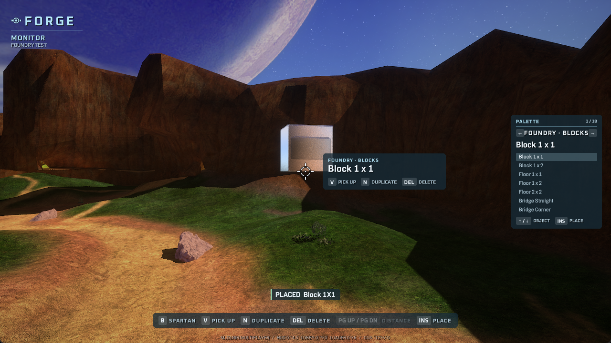

# Foundry Forge pack validation

Evidence recorded on **2026-11-01**, using CU4 and a private, isolated local
`FPK` map fixture. This tests the original 18-piece Foundry set and the new
pack-aware Forge pipeline. See [forge_packs.md](forge_packs.md) for the build and
distribution contract.

## Observed in the game

| Check | Result |
| --- | --- |
| Load custom tags | 72 namespaced tags loaded: 18 piece types × collision, physics, model and crate |
| Place pieces through Forge | All 18 types placed; native object counts confirmed the placements |
| Render the custom actor | The cube and doorway rendered using their new actors and meshes |
| Authored labels | Forge displayed the pack and block labels from the installed catalog |
| Grab and move | The placed cube's position changed through Forge movement |
| Rotate | Rotate-right changed the cube's rotation by 22.5° |
| Save, delete and reload | Reload restored the saved position and rotation after deletion |
| Save pack identities | The `.mvar.packs` file contained 18 bindings with the exact installed archive hash |
| Missing sidecar | Removing the sidecar caused the layout to be refused |
| Changed installed hash | A mismatched inventory hash caused refusal with `needs foundry 0.1.0` |
| Restart and automatic loading | A full game restart restored all 18 custom pieces and the spawn marker from the saved layout |
| Player standing collision | The Spartan settled at Z 4.97 wu on the cube at Z 4.32 wu, matching its 2 m height; remained stable, then fell to Z 0.02 after walking off |
| Floor collision | The Spartan settled at Z 0.69 wu on Floor 2 x 2 at Z 0.52 wu, matching its 0.5 m thickness |
| Ramp traversal | Walking up the ramp raised the Spartan from Z 1.11 to 1.22 and 1.36 wu as Y increased, matching the 1:2 slope |
| Doorway opening and lintel | The player fell through the open centre below the lintel; a drop from above settled on the lintel at Z 11.58 wu, matching its 3 m height above Z 10.60 |

All 18 types were placed and counted; the cube and doorway received representative
visual review in game. The Blender contact sheet and Crosswalk
assembly show the authored geometry and material design. The game build uses
stock material references on the original geometry, so those Blender renders
do not establish the final in-game surface appearance.

## Automated and offline evidence

| Area | Completed checks |
| --- | --- |
| Collision geometry | 9,950 rays against generated collision and the source triangles, including face probes and axis sweeps |
| Launcher | 90 tests passed; 5 ignored. Includes a local HTTP fixture for exact-version dependency download and refusal to replace a live pack |
| Hub | 40 tests passed; type check and focused lint passed. Includes upload/scan/catalog visibility and version validation |
| CLI | 8 focused Forge tests passed; 2 new-tag tests passed. Includes signatures, malformed containers, custom scenario preloads and hyphenated namespaces |
| Live tag lookup | 14 tag-table tests passed; the generated-scenario alias was also verified by live field writes during collision testing |
| Lua | 39 checks passed; 62 Lua files passed syntax/lint checks |
| Native Forge | 684 portable checks passed, including identity guards, paired-file failure injection and BLF marker handling; `/WX` build passed |

The HTTP tests use local fixtures. They establish dependency behavior without
claiming that a Foundry release has been published on the production Hub. The
native file tests cover rollback and preservation of previous layout bytes on
save failures; those failure cases were exercised in the portable harness.

## Pending game checks

- Full visual review, floor/ramp joins, stairs, horizontal doorway traversal,
  window openings and vehicle traversal.
- A fresh launcher profile fetching a published Foundry release and its map.
- Multiplayer placement and saved-layout behavior with a second machine.

Offline ray agreement and the representative standing check do not establish
every traversal case or multiplayer behavior.

The local test installation was removed afterward. Seven pre-existing files
were restored and hash-checked, 230 temporary game files were removed, and the
game's display settings were restored. Generated content and captured test
layouts remain in ignored local build/evidence directories.
