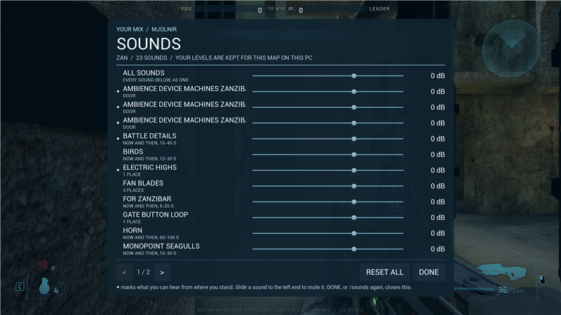

# Sound mixer

`/sounds` (or `/mixer`) in match chat, or `mjolnir_sounds` in the console,
opens a panel over the match with a slider for each sound the map plays.
Each player sets their own levels. They are kept for that map on that PC
and read again whenever the map loads.



## What it lists

One row for each sound tag the Level Loader plays (the level file's
`source`, the Halo 2 or CE tag path):

| Kind shown | What it is | From |
| --- | --- | --- |
| BACKGROUND | a map-wide loop (Halo 2's follow the BSP zone you are in) | `environment.sounds.background` |
| N PLACES | a sound scenery loop placed N times | `environment.sounds.emitters` |
| NOW AND THEN, a-b S | Halo 2 detail one-shots, a random variant every a to b seconds | `environment.sounds.details` |
| MACHINE | a turning machine's one-shots | `gears[].motion.events` |
| DOOR | a moving machine's open, opened and button sounds | `doors[].sounds` |

**ALL SOUNDS** at the top scales every row together. A dot marks the
sounds heard from where the player stands: a background in the current
zone, or a placed sound within its falloff.

Levels run from -24 dB to +12 dB in 1 dB steps. Sliding to the far left
mutes the sound. **RESET ALL** puts every row back at 0 dB. **DONE**
closes the panel and saves the file.

## How it works

- `mods/MJOLNIRLevelLoader/Scripts/mixer.lua` holds the levels.
  `factor(key)` returns the sound's level times ALL SOUNDS as a linear
  gain.
  - `syncVolumes` multiplies each loop's volume by that factor beside the
    game's volume sliders.
  - `details.lua`, `gears.lua` and `doors.lua` multiply each one-shot by
    it when it plays.
- The panel is `WBP_MJOLNIRSoundMixer`, cooked into chunk 984 by
  `build_mjolnir_ui.py`.
  - It is generic: 12 rows that Lua names, fills and collapses, with pages
    for longer lists.
  - Its sliders send no events Lua can take, so the loader reads them 10
    times a second, only while the panel is open.
  - While open, input goes to the UI, so the player stands still. DONE,
    or `/sounds` again, hands input back.
- Levels are saved to `%LOCALAPPDATA%\Meteorite\Saved\MJOLNIR_SoundMix_<map>.json`,
  keyed by tag path, so a rebuilt map keeps them:

```json
{ "version": 1, "map": "ZAN", "levels": { "*": -3, "sound\ambience\zanzibar\zanzibar_ocean_loop\zanzibar_ocean_loop": 4 } }
```

- Without the cooked panel (an older `pakchunk984-MJOLNIRUI`), the
  command logs that the panel is not installed. Sounds then play at
  their built levels.

A level file built before door and gear sounds carried their tag
(`gen_ce_level.py` writes `source` now) keys those rows by the wave's
path, and names door rows by the door's tag and event.
