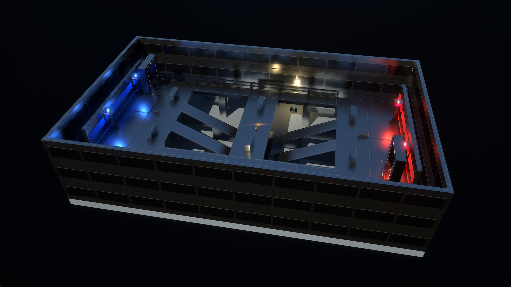
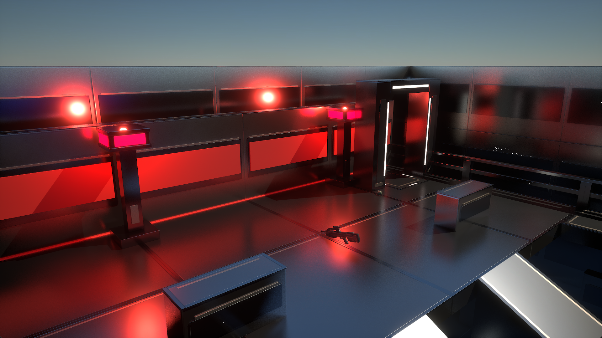
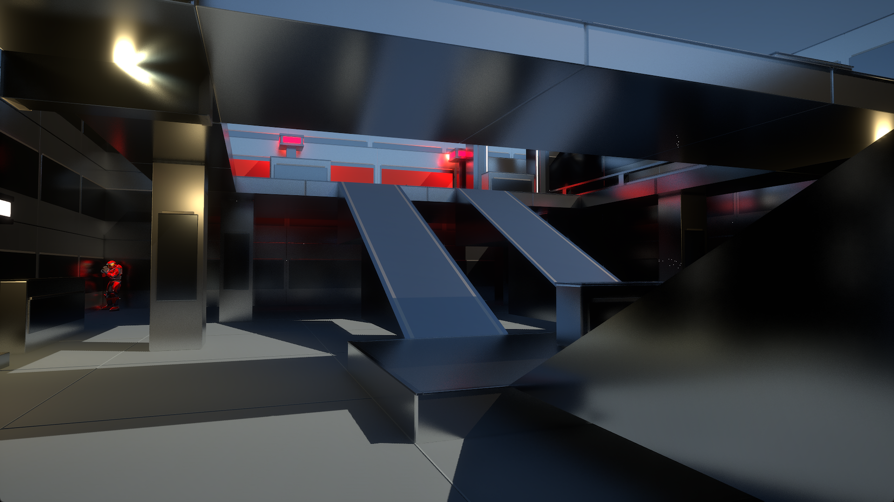
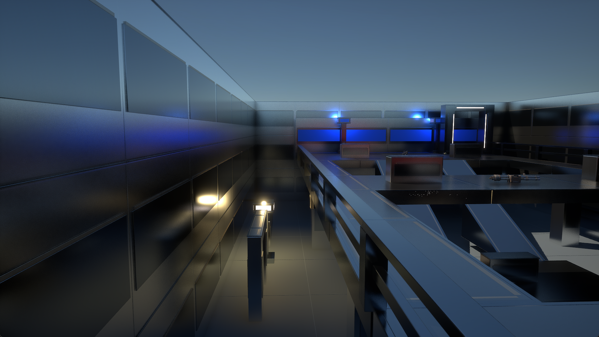
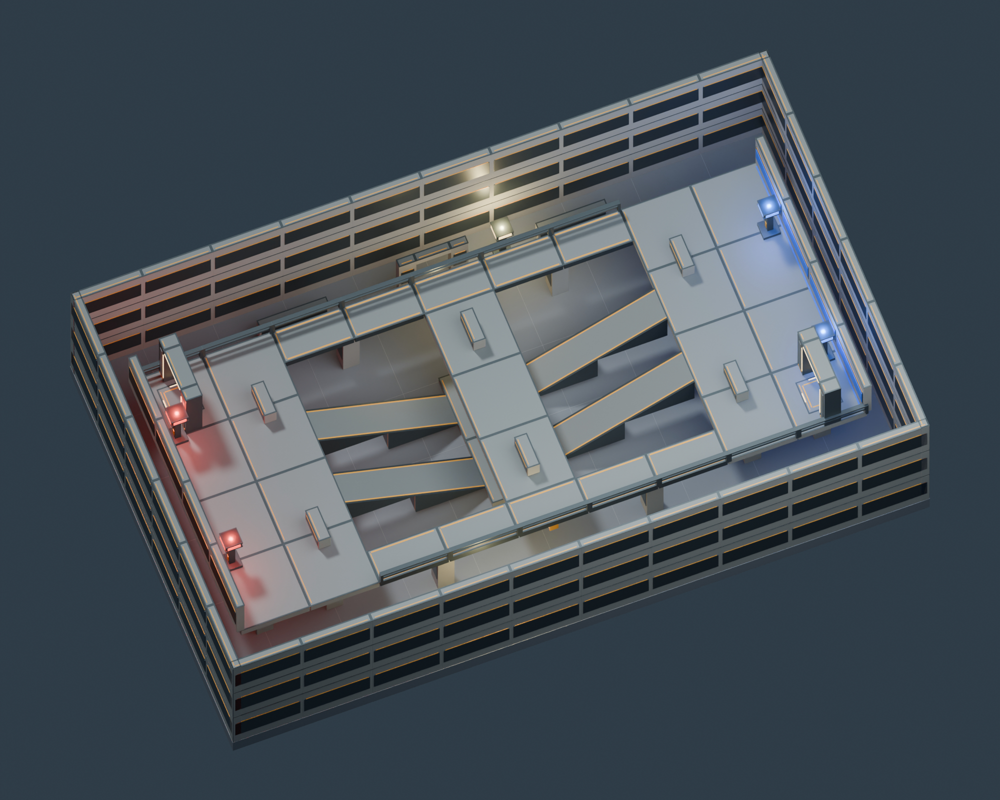

# Forge Canvas and Crossline

Two original maps use the shared Foundry construction kit. Forge Canvas is an
empty 64 × 64 metre deck with a two-metre grid and open sky. Crossline is a
24 × 40 metre Red versus Blue arena with raised bases, ramps, side walkways,
linked teleporters and coloured lights, intended for two to eight players.
A continuous perimeter of 96 Foundry full walls encloses Crossline: three
courses make a 9 m boundary, extending 4.5 m above the raised decks. Interior
railings and openings lead to other playable areas. Forge Canvas stays empty.

These are standalone map archives, with their own collision, world and map
codes: **Forge Canvas / FBK** and **Crossline / FRB**. The editable JSON files
are source templates; installing a map does not install a private saved layout.
The initial versions are local development builds until published through the
Hub. A source build alone does not mean the current public launcher or mods
already include the required pack support.

## Gallery

Actual in-game captures of the enclosed arena:

| Overview | Red base |
| --- | --- |
|  |  |
| **Lower route** | **Perimeter walls** |
|  |  |

### Blender layout previews

These Blender previews use the actual level placements and authored materials.
They show the enclosed layout; game lighting and materials can look different.



[Opposite elevated view](art/crossline-opposite.png) ·
[Overhead layout](art/crossline-top.png) ·
[Blank Forge Canvas](art/forge_canvas.png)

The [wall-piece guide](../forge-packs/foundry/README.md#walls-and-boundaries)
lists full walls, half walls, corners, doorways, windows and railings with
their dimensions and clear openings.

## Play and build

Once the compatible launcher, mods and map releases are published, install
either map from its Hub listing. The launcher downloads the exact Foundry
release and the compatible CE runtime dependency first. Restart the game if
the launcher needs to replace an already mounted pack.

Choose **Forge Canvas → Forge** to start from the empty deck, or
**Crossline → Team Slayer** to play the Red versus Blue layout. Crossline also
offers Slayer and Forge. Forge remains a solo/host authoring mode while its
multiplayer editing path is under development.

In Forge, press **B** to become the Monitor. Use **Left/Right** to choose a
category, **Up/Down** to choose an item, and **Insert** to place it. **V** grabs
or drops a piece, **Page Up/Down** changes its distance, **comma/period** rotates
it, **N** duplicates it, and **Delete** removes it. Foundry pieces display their
authored names. The utility palette contains spawn points and teleporters;
**P** changes a teleporter's channel, which must match its destination.

Press **F5** to save, **F6** to reload the saved layout, or **F2** to restore the
map's authored starting layout. Saved layouts also apply when the map is
played outside Forge. Keep both `<MAP>.mvar` and `<MAP>.mvar.packs` together
when copying a save; the second file records its exact pack and palette
bindings. The launcher resolves missing saved-layout packs before launch.
See [Forge controls](../docs/forge.md) and [pack dependencies](../docs/forge_packs.md).

## Rebuild the maps

Run `python forge-maps/generate.py` to regenerate the editable levels from the
layout source and current Foundry catalog. Make changes there or in a copy of
the level JSON. A new published map needs its own three-character map code
and Hub slug; keep palette ordering stable when updating an existing map.

Build the [Foundry content pack](../forge-packs/foundry/README.md) and the
[two canvas BSPs](../docs/forge_canvas.md) first. The default collision files
are `forge-packs/foundry/build/canvas/blank.sbsp` (64 × 64 metres) and
`arena.sbsp` (24 × 40 metres), with their generated `.canvas.json` receipts.
The build uses the repository's minimal `defs/level/empty_world.umap`; the
baker adds the scenario settings and assigns each map its own world name.
Sky and lighting come from the level JSON.

Create a read-only Paks view containing the game, the tested CE runtime, and
the newly built Foundry `.utoc`/`.ucas` files. Then run:

```powershell
python tools/forge/build_maps.py --paks C:/path/to/combined-paks --runtime '^1.17.0'
```

Use the runtime range actually tested for the release. Optional arguments:
`--only blank` or `--only crossline`, `--version 0.1.0`, `--cli`, `--world`,
`--collision-dir`, `--pack-manifest`, and `--out`. The default pack manifest is
`forge-packs/foundry/build/game/all/mjolnir.json`. The builder refuses a Paks
view whose Foundry container bytes differ from that built pack, or a level
whose pack palette or canvas dimensions no longer match its inputs.

Every run creates a new retained directory under `forge-maps/build/`. It
contains each map's level snapshot, standalone bake, registration record,
`.mjolnir` archive, command log and a report of input/archive hashes. Nothing
is installed into the game. The archives contain the map data and containers;
the launcher generates the shared registration container at installation.
Foundry stays a separate exact-version dependency, so both maps share it.

Local test archives are unsigned. For a Hub submission, pass `--sign` using a
registered device key, or `--sign-seed <file>` using a registered publisher
key. Do not alter an archive after signing. Follow the normal
[map publishing workflow](../docs/map_distribution.md); a successful upload
can still require review. The editable source lives here, separately from
the player archives and locally extracted game data.
