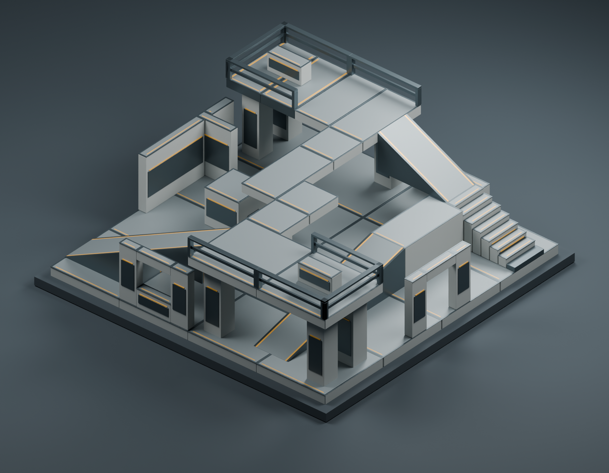

# Foundry modular Forge pack

Original industrial construction geometry for MJOLNIR Forge. Foundry **0.2.0** has **24
pieces**, a **2 m module**, **0.5 m placement snap**, and concrete, gunmetal and
amber materials, with warm, red and blue light lenses. It contains no extracted Halo models or textures. Source and
generated geometry are covered by the repository's MIT license.

The [CU4 validation record](../../docs/forge_pack_validation.md) confirms the original 18
types loaded and placed in a private local fixture, with representative rendering,
save/reload and restart checks. Cube/floor collision, ramp climbing and doorway
opening checks passed; full visual, traversal and multiplayer review remains
pending. Blender renders show the authored material design; the current game
build uses stock material references on this original geometry. The six additions
in 0.2.0 retain all original IDs, geometry and collision definitions.

## Portal and lighting pieces

| ID | Dimensions, metres | Purpose |
| --- | --- | --- |
| `portal_frame` | 4 × 1 × 4 | Open frame with a 2.5 m wide, 3.5 m high aperture |
| `teleporter_pad` | 2 × 2 × 0.5 | Flush landing target with no raised rim |
| `light_strip` | 2 × 0.5 × 0.5 | Warm wall/header light; lens faces local -Y |
| `light_pylon` | 1 × 1 × 3 | Warm freestanding light |
| `light_pylon_red` | 1 × 1 × 3 | Red lens and point light for team routes |
| `light_pylon_blue` | 1 × 1 × 3 | Blue lens and point light for team routes |

For a walk-on entrance, place the frame bottom at floor height and inset the
pad so its top is flush or at most 2 cm above the floor, as in Crossline. Keep
at least 3 m of clear height above the pad for the receiver's approximately
1.98 m player shape and 0.61 m preflight lift. The frame contains three separate collision
hulls; it has no invisible threshold, portal plane or enclosing collision box.

Frame and pad are scenery. A functioning teleporter also needs the game's
separate sender/receiver or two-way marker, placed just above the pad. Begin
channel numbering at `alpha` and keep it dense. Existing conversion defaults
use a cylinder with radius 0.35 world units, positive height 0.6 and negative
height 0.1 (one world unit is 3.048 m). Keep receivers clear of walls and cover;
the engine rejects blocked landing shapes. The engine tracks at most 32 ends.
Facing follows the native marker convention, not the symmetric housing. See
[`build_spawn_point.sh`](../../tools/level/build_spawn_point.sh) and
[`gen_ce_level.py`](../../tools/level/gen_ce_level.py) for marker creation,
channels and sender-facing conversion.

Light blocks declare the same optional `light` object in `catalog.json` and
`source/geometry.json`: `offset_m`, `color_rgb`, `intensity_cd`, and `radius_m`.
Offsets use the source metre/Z-up axes; the runtime converts them to Unreal
centimetres and reverses Y. The strip uses **2,500 cd over 6 m**; all three
pylons use **7,000 cd over 8 m**. These intensities account for the level
loader's fixed exposure: a local game check confirmed a visible warm light
pool from a 7,000 cd pylon at 5 m elevation. Their light is movable and
shadowless. The Blender lens material uses
emission, while actual in-game illumination comes from the attached point light.

## Playable map sources

[Forge Canvas and Crossline](../../forge-maps/README.md) use this pack in
standalone map builds. Forge Canvas provides a blank 64 × 64 m construction
deck. Crossline is a 24 × 40 m Red versus Blue arena with raised bases, ramps,
walkways, two-way teleporters and team lights. Their editable level JSON,
rebuild commands and current distribution status are documented alongside
the maps. [Crossline's Blender preview](../../forge-maps/art/crossline.png)
renders those exact placements with authoring materials; it is not a game
screenshot.

## Rebuild

From the repository root, using normal Python and Blender 5.2 LTS:

```powershell
python forge-packs/foundry/generate.py
python forge-packs/foundry/validate.py
& 'C:\Program Files\Blender Foundation\Blender 5.2\blender.exe' `
  --background --factory-startup `
  --python forge-packs/foundry/build_blender.py -- --render
```

The first two commands need only the Python standard library. The Blender build
regenerates and validates sources before exporting. No Blender MCP, add-ons,
network services or texture downloads are required. Tested with Blender 5.2.3
LTS (`e13b728c6880`). Omit `--render` for a fast asset rebuild.

`catalog.json` is the authoring manifest input. Runtime installation additionally
requires cooked tag/visual content produced by the game's packaging pipeline;
these source GLBs are not themselves an installable game pack.

## Outputs

| Path | Purpose |
| --- | --- |
| `catalog.json` | Names, stable IDs, tag paths, categories, dimensions and snap |
| `source/geometry.json` | Authoritative portable mesh/collision data, in metres and Z-up |
| `build/models/*.glb` | One visual asset per piece, conventional glTF metres and Y-up |
| `build/models/*.gltf` + `*.bin` | Equivalent unpacked glTF for the native mesh cooker |
| `build/collision/*.json` | Collision vertices, triangle indices and separate convex hulls |
| `build/collision/*.obj` | Same collision in metres/Z-up, with a group per hull |
| `build/foundry.blend` | Editable mesh asset library and contact-sheet scene |
| `build/foundry-contact-sheet.png` | Actual Blender render of all 24 models |
| `art/foundry-contact-sheet.png` | Reviewed render copied into Git for the pack/PR preview |
| `build/export-report.json` | Blender version, file sizes and triangle counts |

Generated `build/` artifacts are ignored by Git. The small JSON geometry is
committed so collision conversion can run without Blender. `generate.py` is the
editable source; regenerate the JSON after changing it. The `.blend` places
objects on a presentation grid, while the exported GLBs keep each object's local
origin at zero. In Blender, asset drag/drop uses that local origin.

## Coordinate and collision contract

- Source coordinates are **metres**, right-handed **Z-up**. Blender is configured
  with a metre unit scale. The glTF exporter performs its normal Y-up conversion.
- All origins are at the centre of the bounding footprint, on the bottom plane.
  A 2 m cube therefore spans `[-1,-1,0]` through `[1,1,2]`.
- Ramp/stair low ends face `-Y`; high ends face `+Y`. Both ramps rise exactly 2 m.
- Dimensions describe collision bounds. Decorative bevels and material inserts
  stay inside those bounds; walkable faces and nominal docking planes align.
- Each `collision.hulls[]` entry is an independently closed, outward-wound,
  triangulated convex solid. `collision.vertices` and `collision.triangles` are
  the concatenated equivalent with triangle indices already offset.
- Composite objects contain multiple hulls. Preserve them when cooking: taking
  one bounding convex hull would seal the doorway/window or fill the L corner.
- Shared internal faces between abutting hulls may occur. Do not interpret a
  whole composite as one manifold shell; cook the separate hulls or union them.
- Door opening: 2 m wide × 2.5 m high. Window opening: 2 m wide, Z=1..2.5 m.
- Stairs have eight 0.25 m rises and 0.5 m treads. Their collision follows the
  visible stairs; the separate ramp pieces provide smooth alternatives.

`validate.py` checks finite coordinates, outward winding, nondegenerate triangles,
closed edges, convex hulls, dimensions, origins, empty apertures and ramp joins.
These authoring checks do not replace runtime collision and placement tests.

## Native collision and physics

The native collision builder creates exact triangle BSPs and MOPPs from these
sources. It seeds two distinct open leaves and links every two-sided face, then
checks short rays through every face and full-axis sweeps against the original
triangles. The original 18-piece validation passed 9,950 rays without a miss,
phantom or displaced hit; the native rebuild reports the current inventory's total.

```powershell
# Paks and CLI paths are local developer installations. Extracted donors and
# cooked outputs are game-specific local build artifacts and stay under build/.
$paks = 'C:\Program Files (x86)\Steam\steamapps\common\Halo Campaign Evolved\Meteorite\Content\Paks'
$cli = 'target\debug\mjolnir.exe'
& $cli extract --paks $paks --group collision_model --filter crate_space_a `
  --shipped-only --verify --out forge-packs/foundry/build/donors
cargo run -p blam-sbsp --example forge_collision -- `
  forge-packs/foundry/source/geometry.json `
  forge-packs/foundry/build/donors/objects/props/covenant/crate_space_a/crate_space_a.collision_model `
  forge-packs/foundry/build/blam-collision
python tools/forge/build_collision.py forge-packs/foundry/source/geometry.json `
  forge-packs/foundry/build/blam-physics --mjolnir $cli --paks $paks `
  --payload-out forge-packs/foundry/build/blam-collision
```

The physics builder uses each source convex hull directly, with outward plane
equations and grouped four-vector data. Compound parts reference a list of
separate polyhedra, preserving all openings. Rigid bodies are fixed at node 0,
and Havok inflation radius is zero to preserve grid bounds. Metres become Blam
units by division by 3.048, without changing the source axes. The game handles
Blam-to-Unreal coordinate conversion. Both the cooked physics containers and
verified raw payloads are emitted without touching the installed game. Use
`--only block_1x1` for a single-part build or `--commands-only` to inspect edits.

## Crosswalk assembly fixture



[`demo/crosswalk.layout.json`](demo/crosswalk.layout.json) places **54 instances
of the original 18 part types** inside a 16 × 16 m footprint. The two main decks are 4 m
above the lower floor, leaving 3.5 m under the bridge. Consecutive ramps, a
stair-to-ramp route, an intermediate landing, open doorway/window, cover and
guardrails exercise the kit's connections.

This is a portable authoring fixture, not a native Forge save or baked map. Its
positions are metres/Z-up and rotations are XYZ Euler degrees, with yaw around
+Z. A runtime adapter must resolve the pack's palette bindings and convert
positions to Blam units. The fixture pins the authoring pack to Foundry 0.1.0;
release IDs/checksums must come from the published release when preparing a
downloadable map. Its `checks` list describes traversal and save/reload tests.

```powershell
python forge-packs/foundry/generate_demo.py
& 'C:\Program Files\Blender Foundation\Blender 5.2\blender.exe' `
  --background --factory-startup --python forge-packs/foundry/build_demo.py
```

The second command reads the actual mesh library from `build/foundry.blend` and
writes `art/foundry-crosswalk.png` plus the ignored `build/crosswalk.blend`.
The generator verifies that all 18 types are represented and every collision
vertex remains inside the stated footprint. The image is an actual Blender
render; gameplay verification is recorded separately.

See [design research](../../docs/forge_pack_design.md) for references and future sets.
