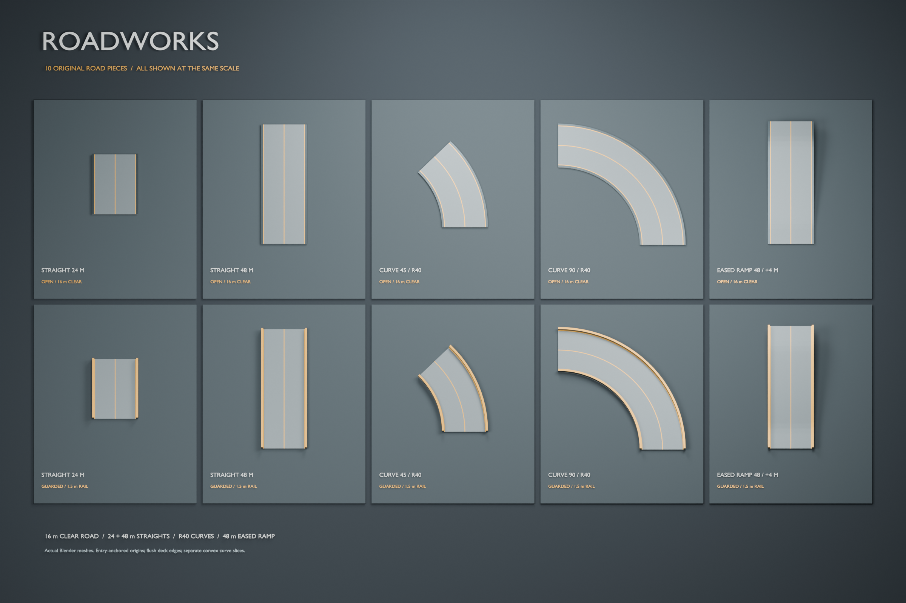

# Roadworks modular Forge pack

Roadworks **0.2.0** is an original vehicle road kit: **ten pieces**, a **16 m
clear roadway**, **24/48 m straights**, **40 m radius curves**, and a **48 m
eased ramp rising 4 m**. Every shape has an open and a guarded version. The
guarded version adds solid 1.5 m barriers outside the driving lane. Concrete,
gunmetal and flush amber markings match the Foundry construction kit.

The first 8 m kit felt too tight in vehicle playtesting. This revision doubles
its XY footprint, widens the shoulders to 0.8 m and halves the ramp grade,
while keeping the stock Warthog and player at their original game scale.
Original Foundry and Forge Canvas retain their existing dimensions. Crossline
has a separate enlargement using the Foundry Wide pack.



This is a Blender render of the authored meshes. The game build uses existing
game material references on these original meshes, so its appearance can differ.
The geometry and authoring scripts contain no extracted Halo models or textures
and use the repository's MIT license.

## Vehicle scale

The installed Warthog's assembled visual envelope is **6.13 m long × 3.25 m
wide × 2.43 m high**, and the standing Spartan collision height is **1.981 m**.
One centred Warthog has about 6.375 m spare on each side of the nominal 16 m
lane. Two visual widths leave 9.5 m in total for outer clearance and passing
space; driving tests determine how comfortable that feels. See the reproducible
[installed-tag measurements](SCALE.md) for collision, wheelbase and source details.

| Piece family | Width | Run or curve | Rise | Intended use |
| --- | ---: | ---: | ---: | --- |
| Foundry straight bridge | 2 m | 4 m | 0 | Pedestrian walkways |
| Foundry ramp | 2 m | 4 m | 2 m | Compact player routes |
| Foundry shallow ramp | 2 m | 8 m | 2 m | Longer player routes |
| Roadworks straights | 16 m clear / 17.6 m total | 24 or 48 m | 0 | Vehicle lanes and staging decks |
| Roadworks curves | 16 m clear / 17.6 m total | R40, 45° or 90° | 0 | Connected vehicle corners |
| Roadworks eased ramp | 16 m clear / 17.6 m total | 48 m | 4 m | Vehicle elevation changes |

Roadworks curves have 3.75° convex segments. Their radial clear width is 16 m;
the minimum clearance measured perpendicular to a flat facet is about 15.991 m.
The ramp has 4 m level noses, 8 m slope transitions and a maximum 12.5% grade.
Its driving surface and guardrails share the same sampled height profile.

## Pieces and connections

| Base ID | Exit position, source metres | Exit flow | Collision hulls, open / guarded |
| --- | --- | --- | ---: |
| `straight_24` | `(0, 24, 0.5)` | `(0, 1, 0)` | 1 / 3 |
| `straight_48` | `(0, 48, 0.5)` | `(0, 1, 0)` | 1 / 3 |
| `curve_45` | `(-11.715728753, 28.284271247, 0.5)` | `(-0.707106781, 0.707106781, 0)` | 12 / 36 |
| `curve_90` | `(-40, 40, 0.5)` | `(-1, 0, 0)` | 24 / 72 |
| `ramp_48` | `(0, 48, 4.5)` | `(0, 1, 0)` | 11 / 33 |

Append `_guarded` to any base ID for the matching barrier variant. There are
no extra collision boxes across the inside of a curve. Each road segment is
its own closed convex prism, with barriers as two additional prisms.

All origins are at the **entry floor**, with local **+Y forward**, **+Z up**,
and the entry driving surface at **`(0, 0, 0.5)`**. This deliberately differs
from Foundry's bottom-centre origin. Deck thickness is 0.5 m. Rails occupy
local lateral coordinates `[-8.8, -8]` and `[8, 8.8]`, and extend 1.5 m above
the road. Their faces and the road surface meet exactly at connected ends.

The `road.connectors` metadata in the catalog and source describes each
connector's `position_m`, `forward`, `up`, `clear_width_m` and two full-deck
`edge_points_m`. **Both forward vectors are travel tangents**, rather than
outward socket normals. `road.sections` contains every exact collision cross
section, useful for assembling and testing layouts. This metadata assists
source authoring; the current Forge interface does not automatically dock
pieces using it.

For a simple left corner, place a straight at `(0, 0, 0)`, then the next
piece's entry at that straight's exit XY, keeping its origin Z unchanged.
After a 90° curve, rotate the following straight **+90° in source Z-up
coordinates** and place its origin at the curve's exit XY. The 40 m quarter
turn fits the 0.5 m grid. A 45° curve has irrational endpoint coordinates:
use the authored connector values rather than rounding its endpoint to the
grid. Two 45° curves produce the same endpoint and heading as one 90° curve.

To descend, connect to the ramp's high end, traverse it backwards, and rotate
the ramp 180° relative to an ascending ramp with the same travel heading.
The two level noses let ramps connect to flat straights without a vertical
lip or immediate pitch step. A ramp-up, 48 m high straight and reverse ramp
return to the original height over a 144 m route.

Layouts authored for 0.1.0 need their road placements rebuilt for 0.2.0:
`straight_12` becomes `straight_24`, the old long `straight_24` becomes
`straight_48`, and `ramp_24` becomes `ramp_48`. Curve IDs remain the same but
their radius and width double. Use each map's exact pack version dependency;
old placement coordinates are not compatible with the enlarged geometry.

Level JSON uses Unreal centimetres: source `(x, y, z)` becomes
`(100x, -100y, 100z)`, and source Z yaw changes sign. For an elevated road
whose driving surface should be 3 m high, set the entry-floor origin to 2.5 m.
The [Roadworks Circuit map sources](../../forge-maps/README.md) demonstrate
connected roads, a pit area, a raised section and stock vehicle placement.

## Rebuild and verify

From the repository root:

```powershell
python forge-packs/roadworks/generate.py
python forge-packs/roadworks/validate.py
& 'C:\Program Files\Blender Foundation\Blender 5.2\blender.exe' --background --factory-startup --python forge-packs/roadworks/build_blender.py -- --render
```

The checked-in `generate.py`, `catalog.json` and `source/geometry.json` are the
authoritative editable source. Blender exports separate `.gltf` + `.bin`, GLB,
collision JSON/OBJ, a `.blend` asset library and a contact sheet into ignored
`build/`. glTF is metre/Y-up; collision JSON/OBJ remains metre/Z-up. Presentation
scaling is applied only after the full-size model exports. No Blender add-on
or network service is required.

Each source piece authors a finite **300 m draw distance** through
`render_distance_m`. The native pack builder writes it to the model tag so
long sections remain visible across the circuit. This authoring setting is
separate from the Hub catalog and does not change geometry or collision.

The portable validator checks 196 closed, outward, convex collision hulls and
2,352 triangles across the ten assets, exact shared faces and connector edges,
3,430 driving-surface samples, guardrail clearance, open curve centres,
complete loop closure, paired 45° turns and reverse ramp descent. The largest
piece has 72 hulls and 864 collision triangles. These checks establish geometry
and connector consistency; the [CU4 validation record](../../docs/forge_pack_validation.md)
tracks actual game testing separately. Driving, suspension, braking, high-speed
cornering and multiplayer behaviour require in-game checks.

The authored source is not an installable pack by itself. The generic native
pack pipeline cooks collision/physics, model tags, actor wrappers and visual
containers, then creates the `.mjolnir` archive. Publication and compatible
launcher/mod releases are separate steps.

## Design references

Halo's official Forge showcases include the multi-level vehicle circuit
**Death Race** and **Alien Motor Speedway**, useful examples of readable turns,
vertical routes and vehicle play spaces. Roadworks takes the general modular
road use case from that genre; its geometry is original.
[Halo Waypoint, Forge Features, April 23, 2026](https://www.halowaypoint.com/news/forge-features-april-23-2026).
