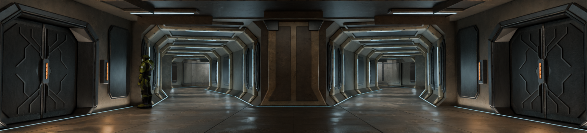

# Enclosed facility — Blender art review

R18, 26 October 2026. The interior received **8.0/10** in a fresh dream-loop
review against the lower panel of the approved
[indoor-only concept](../facility-concept-v3-indoor.png). Shape, whole-frame
lighting and material identity passed; finer detail can still improve.
This is a Blender art milestone, not game or performance validation.

Two mirrored entrances on the same arena-facing wall connect through enclosed
vestibules, ribbed branches and lateral turns around solid structural wedges.
Eight sealed service-door niches suggest a larger inaccessible facility.
The doors have connected, tapered angular relief around slim amber indicators.
Mineral walls, worn metal leaves, irregular floor reflections and local bevel
wear share the owned source palette and exported UVs.

The five images are actual 96-sample Cycles renders:

- [Red entrance](facility-red.png)
- [Blue entrance](facility-blue.png)
- [Connecting hall](facility-interior.png), 1715×392, matching the concept panel
- [Passage and indoor turn](facility-route.png)
- [Sealed door and material detail](facility-door.png)

The review accepted the final connected door wings and retained the earlier
lighting, surface and edge-wear improvements. Remaining fine-detail suggestions
are clipped/offset foreground plate joints and a smoother amber diffuser.
The actual stock light atlas is retained. The cyborg remains an unposed local
scale reference. Real terminal corners are oblique because the traversable
turns must stay open; no false wall was added to imitate the painting.
Exterior base positions and native scenery remain at their map anchors, so
those images are not claims of exact exterior concept matching.

[Validation evidence](facility-validation.json) records the exact source and
image hashes: 1,470 facility route samples, 162 fixtures, 206 original layout
checks, closed structure, native-rock clearance, relative owned textures and
97,244 authored faces preserved through preview preparation. A renderer fix
prevents legacy fallback styling from replacing their roles, shader paths or
exported UVs; six regression tests cover that behavior. Thirteen focused
material/normal and amber-shader tests also pass.

Source SHA-256:
`f403a49b17d3769fbf642ac6db5d3298285e9f4bf9beab3b9b99f79c732e0c51`.

See the [build guide](../facility-build.md) for editable source ownership,
dimensions and reproduction commands, and the [art provenance](../README.md)
for generated textures and complete prompts. Installed-game meshes/textures
remain local dependencies; the assembled preview is excluded from source control.

No facility JMS export, HEK bake, native cook, game launch, multiplayer match or
runtime FPS test was performed. `tst_export_pending` remains true and the
published beta is unchanged. Game integration and playtesting are the next stage.
